# Felhasználói kézikönyv

> **Angolul / Spanyolul / Portugálul / Németül / Olaszul / Kínaiul:** [User guide](i18n/en/USER_GUIDE.md) ·
> [Guía del usuario](i18n/es/USER_GUIDE.md) · [Manual do utilizador](i18n/pt/USER_GUIDE.md) ·
> [Benutzerhandbuch](i18n/de/USER_GUIDE.md) · [Guida dell'utente](i18n/it/USER_GUIDE.md) ·
> [用户指南](i18n/zh/USER_GUIDE.md)
> (ugyanez a dokumentum angolul, spanyolul, portugálul, németül, olaszul és kínaiul). A felület nyelve a *Beállítások → Megjelenés → Nyelv* alatt
> váltható.

A bike-osm-ride használata az első indítástól a tekerés összegzéséig. A telepítés és a rövid áttekintés a
[README](../README.md)-ben van; a fejlesztői részletek az [`ARCHITECTURE.md`](ARCHITECTURE.md)-ben és társaiban.
A képernyőképek a 0.3.0-s verzióról készültek, a dokumentumban látható útvonal a BRouter egy valódi, a repóban
tesztadatként szereplő útvonala (© OpenStreetMap-közreműködők, ODbL).

**Tartalom:** [Első indítás](#első-indítás) · [Útvonal](#útvonal-betöltése) · [Eszközök](#eszközök-csatlakoztatása) ·
[Tekerés](#tekerés) · [A képernyő](#a-képernyő-és-az-elrendezés) · [Edzések](#edzések) ·
[Virtuális váltó](#virtuális-váltó) · [Szellem és PR](#szellem-és-szegmensek) ·
[Összegzés és TCX](#összegzés-és-tcx) · [Street View](#street-view-opcionális) ·
[Telefon](#telefon-és-tablet) · [Beállítások](#beállítások) · [Billentyűk](#billentyűparancsok) ·
[Hibaelhárítás](#hibaelhárítás)

## Első indítás

Indításkor az **Útvonal** ablak nyílik meg az üres tekerés-képernyő fölött. Három út van a kezdéshez: GPX-fájl,
bikerouter-link vagy a bemutató útvonal. Hardver nélkül is végigtekerhetsz a **Szimulált tekerővel** (lásd
[Eszközök](#eszközök-csatlakoztatása)).

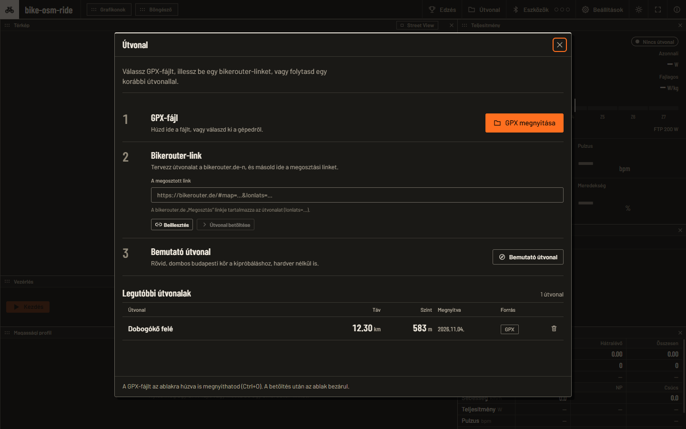

## Útvonal betöltése

- **GPX-fájl.** Tallózással (`GPX megnyitása`, `Ctrl+O`) vagy az ablakra húzva. Bármilyen GPX jó: a program a
  `<trk>`/`<trkseg>` pontokat használja (több szakaszt egymás után fűz), ennek hiányában az `<rte>` pontokat;
  ékezetes, BOM-os, névterekkel tarkított fájlt is megért; a hibás (levágott) fájlra érthető hibaüzenetet ad, nem
  rövidített útvonalat. A mérethatár 64 MB.
- **Bikerouter-link.** Tervezz útvonalat a [bikerouter.de](https://bikerouter.de)-n, kattints a *Megosztás* linkre, és
  másold a mezőbe (`Beillesztés`, majd `Útvonal betöltése`). A linkből a pontok, a profil, az alternatíva és az
  elkerülők is átkerülnek; az útvonalat a BRouter szervere számolja. A nyers BRouter-címek és a `lonlats=…`
  paraméterek is megfelelnek.
- **Bemutató útvonal.** Egy rövid, dombos budapesti kör a kipróbáláshoz (a koordinátái az utak *közelében* futnak,
  nem rajtuk).
- **Legutóbbi útvonalak.** Az utolsó 20, adatokkal (táv, szint, mikor nyitottad meg, forrás); a kuka törli a
  listából (a tekerés-napló megmarad).

Ha a GPX-ben nincs (használható) magasságadat, a program az Open-Meteo szolgáltatástól kéri el (a koordináták
mennek ki); ha ez sem sikerül, az útvonal lapos profillal töltődik be, és figyelmeztet. A fájlból:

- ha a fő track mellett van egy *rövidebb* track, amely az útvonalon fekszik (például egy beletett Strava-szegmens),
  vagy egy `<type>segment</type>` jelölésű track, az **szegmens** lesz: sávként látszik a profilon, tekerés közben
  „Szegmens: … X km hátra” kiírás jelzi (a Strava saját GPX-exportja nem tartalmaz szegmenst);
- ha *minden* ponthoz tartozik időbélyeg (Strava- vagy Garmin-export), az útvonal **a saját szelleme** is: lásd a
  [Szellem](#szellem-és-szegmensek) fejezetet.

A program az útvonalból **emelkedőket** keres: legalább 500 m hosszú, legalább 3 %-os átlagú, legalább 25 m szintet
nyerő szakaszok, 4-től HC-ig kategóriával (hossz × átlagos meredekség szerint).

## Eszközök csatlakoztatása

A felső sáv **Eszközök** gombja (mellette három pont mutatja, hány szerep csatlakozott). Öt szerep van:
**Trainer** (okos trainer, FTMS), **Pulzus**, **Teljesítménymérő** (CPS), **Cadence-szenzor** (CSC) és **Váltó**
(Zwift Click/Play).

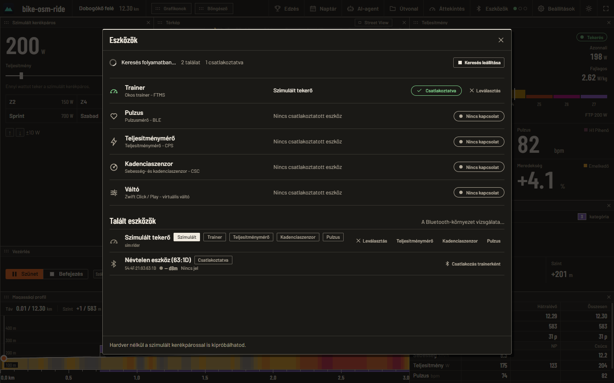

1. A **keresés magától elindul**, amint az ablak megnyílik, és addig fut, amíg nyitva van (csatlakozási kísérlet közben
   pár másodpercre eláll, aztán visszaáll). A program szűrés nélkül keres, és a hirdetett szolgáltatások alapján sorolja
   be az eszközöket; a gombbal bármikor leállíthatod és újraindíthatod.
2. A talált eszköz mellett a szerepek gombjai: arra a szerepre csatlakoztatod, amelyre kell. Egy fizikai eszköz
   **egyszerre több szerepet** is elláthat: ha a trainered a teljesítményt, kadenciát vagy pulzust is sugározza, egyetlen
   kapcsolat tölti ki az összes kártyát (a kártyákon *közös eszköz* jelzés látszik). A szenzorok adatai közül a
   pontosabb forrás nyer (teljesítmény: teljesítménymérő a trainer előtt; kadencia: CSC, majd a teljesítménymérő, majd
   a trainer; pulzus: mellkasöv a trainer előtt).
3. **„Csatlakoztatva” jelölésű sorok:** ezek az eszközök már kapcsolatban állnak a géppel vagy a telefonnal — tipikusan
   a trainer, amit a telefon magától visszakapcsolt, vagy amit egy másik alkalmazás tart. Nem hirdetik magukat, ezért a
   keresés önmagában sosem találta volna őket. Ha a kapcsolatot **másik alkalmazás** tartja (Androidon két GATT-kliens
   nem fér ugyanarra az eszközre), a sor elmondja, hogy ott kell elengedni; máskülönben a sor normál csatlakozó gombot ad.
   Névtelen eszköznél is van *Csatlakozás trainerként* gomb — a szolgáltatás-felderítés csatlakozás után eldönti, hogy
   tényleg trainer-e.
4. Ami 3 másodperce nem frissült, az „—”-ra vált; megszakadt kapcsolatnál a program háromszor újrapróbálja.
5. **A trainert a Trainer szerepben csatlakoztasd**: a teljesítménymérő szerep csak olvas, a vezérlést (emelkedők,
   ERG) a Trainer szerep adja.
6. **Szimulált tekerő**: a lista első eleme, mindig ott van, Bluetooth nélkül is. A bal oldali panelen egy csúszkával
   (vagy `↑`/`↓`, ±10 W) adhatod meg a wattot, gyorsgombok: Z2 150 W, Z4 250 W, Sprint 700 W, Szabad 0 W. A kadencia és
   a pulzus hihetően követi.

**Hogyan vezérli a trainert?** Emelkedőn a trainer az előtted lévő szakasz meredekségét kapja (kb. 5–45 m előre,
simítva, legfeljebb ±20 %-ig, a *Meredekség erőssége* beállítással 0–150 %-ra skálázva). Szünetnél és a végén a
trainer lapos, semleges ellenállásra áll. Edzésnél (ERG) a célwattot tartja. A trainer *biztonsági szűrőn* át kapja
a parancsokat: csak a szükséges műveletek mennek ki, a célok a trainer saját tartományára vannak vágva.

> **Fontos, őszintén.** Az ERG-vezérlést egy valódi trainerrel (VE200) kipróbáltuk, az emelkedők szimulációját
> valódi trainerrel még nem igazoltuk, a Zwift Click/Play kontrollert, a külön pulzusmérőt és teljesítménymérőt
> valódi eszközzel még nem próbáltuk. A részletek: [`TESTING.md`](TESTING.md).

## Tekerés

`Kezdés` (vagy `Szóköz`) indítja a tekerést, `Szünet` megállítja (az idő is áll), `Befejezés` lezárja. **Az útvonal
végét elérve a tekerés nem ér véget**: a program értesít, és folytatódik — **körútnál új kör indul a rajtról, nem
körútnál visszafelé indulsz ugyanazon az útvonalon** (a visszaút végén megint megfordul, és így tovább, amíg a
*Befejezés*-t meg nem nyomod). Így egy az útvonalnál hosszabb edzés is kifut, és szabad tekerésben is mehetsz, ameddig
akarsz. A táv, a hátralévő út és az ETA az aktuális **szakaszra** értendő (a telefon Tekerés fülén felül egy
„*2. szakasz*” jelzés mutatja, hol tartasz); az összegzés a teljes menetet számolja. A szellem és az emelkedő-PR az
első szakaszon értelmes (a későbbi körök saját időbélyeggel bekerülnek a naplóba, de a PR-keresés nem viszi őket).
Kezdés előtt a profilra kattintva az útvonal bármely pontjára ugorhatsz; tekerés közben ez
nem megy. A program ébren tartja a gépet, amíg tekersz (Windows, Linux, macOS; Androidon nem).

A sebesség a mért **wattból** jön, a közúti mérésekkel validált Martin-féle modellel (gravitáció, gördülés,
csapágysúrlódás, légellenállás küllőkkel, tehetetlenség), a testsúlyodból, a bicikli súlyából, a CdA-ból és a Crr-ből;
a *trainer sebességének használata* kapcsolóval a trainer saját sebességét is használhatod. Részletek:
[`SIMULATION.md`](SIMULATION.md).

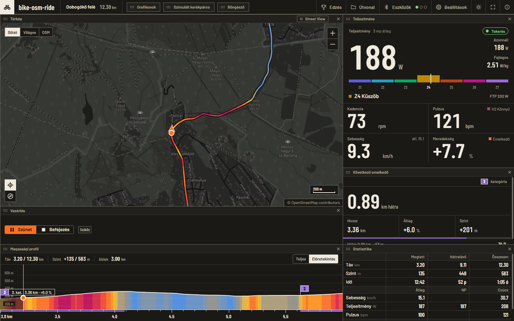

## A képernyő és az elrendezés

A tekerés-képernyő **panelekből** áll: *Térkép*, *Teljesítmény* (a nagy szám, 3 mp-es átlag, W/kg, zóna), *Következő
emelkedő*, *Statisztika*, *Magassági profil*, *Vezérlés*, *Grafikonok*, *Edzés*, *Szimulált kerékpáros*, *Váltó*,
*Böngésző*. Úgy működnek, mint egy tiling ablakkezelőben: **nincs átfedés és nincs lyuk.**

- **Átméretezés:** az elválasztót húzva (a vonal egy 96 × 64-es rács celláira ugrik, a panelek minimális méretét
  tiszteletben tartva; csak a két szomszédos panel változik).
- **Mozgatás:** a panel fejlécénél fogva egy másik panel *szélére* ejtve kettéosztja azt, a *közepére* ejtve helyet
  cserélnek (szellemkeret mutatja, mi lesz).
- **Bezárás:** a panel × gombja; a szomszédja kitölti a helyét, a panel *chipként* a felső sávba kerül. A chipre
  kattintva oda tér vissza, ahol volt; a felületre húzva oda, ahová ejted.
- **Minden mentődik.** *Beállítások → Elrendezés → Elrendezés visszaállítása* az alaphelyzetet hozza vissza.
- Az elrendezést (és a profil nézetét) a program **külön jegyzi edzéssel és edzés nélkül**: a kiválasztott edzéshez
  saját elrendezés tartozik, amely addig a szabadot követi, amíg ott nem alakítod át.

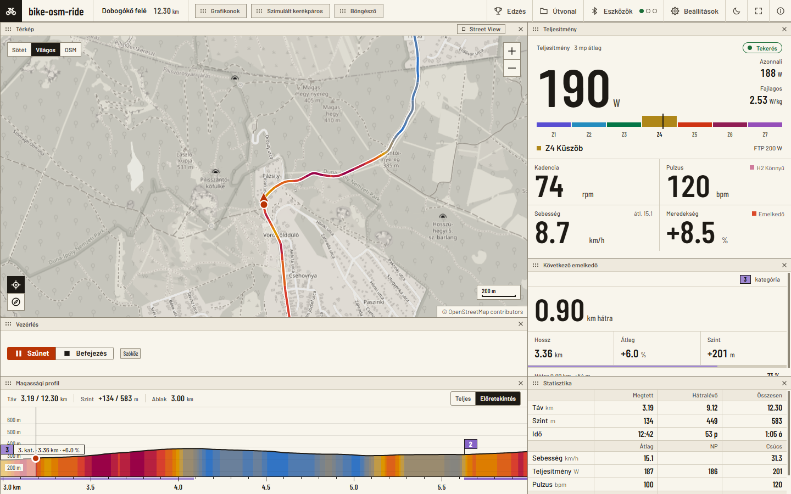

**Térkép.** A térkép a standard OpenStreetMap-csempéket mutatja; a *Sötét* és *Világos* stílus helyben szűri őket,
az *OSM* az eredeti. Görgővel nagyítasz az egér körül, húzással tologatod; a bal alsó gombokkal követő módba
és középre állítod (`M`). Az útvonal színe az emelkedőt jelzi (hideg: lejtő, szürke: sík, sárga–narancs–piros–bíbor:
egyre meredekebb emelkedő), a bringás a nyíllal jelölt korong. Alul az OSM-hivatkozás és a méretarány.

**Magassági profil.** `Teljes` (az egész útvonal) vagy `Előretekintés` (a következő ~3 km; hossza a beállításokban
állítható, `P`); az emelkedők zászlóként a kategóriával, a km-beosztás alul; kattintásra ugrás (tekerés előtt),
egérre adatkiolvasás. Az előretekintő skála csak akkor vált, ha muszáj. Ha van kiválasztott edzés, a **Magasság |
Edzés** kapcsoló az edzés blokkjait mutatja.

**Szövegméret.** *Beállítások → Megjelenés → Szövegméret* (80–160 %).

**Nyelv.** *Beállítások → Megjelenés → Nyelv*: „Automatikus” (a rendszer nyelvét követi, ha annak a szövege
hiánytalan), „Magyar”, „English”, „Español”, „Português”, „Deutsch”, „Italiano”, „简体中文”. A váltás azonnal érvénybe lép; a korábban elnevezett útvonalak és
tekerések nevét nem írja át (azok maradnak, ahogy elnevezted őket).

## Edzések

A felső sáv **Edzés** gombja (vagy `W`). A beépített könyvtár **93 edzés**, 12 kategóriában (regeneráció, állóképesség,
tempó, sweet spot, küszöb, VO2max, anaerob, sprint, hegymászás, verseny, teszt, vegyes), köztük 20 és 8 perces FTP-teszt,
ramp- és CP-tesztek, és sok, publikált kutatás protokollját követő ülés (Rønnestad 30/15, Seiler 4 × 8, Helgerud 4 × 4,
Billat 30/30, Gibala sprintintervallum és mások; a források edzésenként a `workouts.json` `sources` mezőjében).

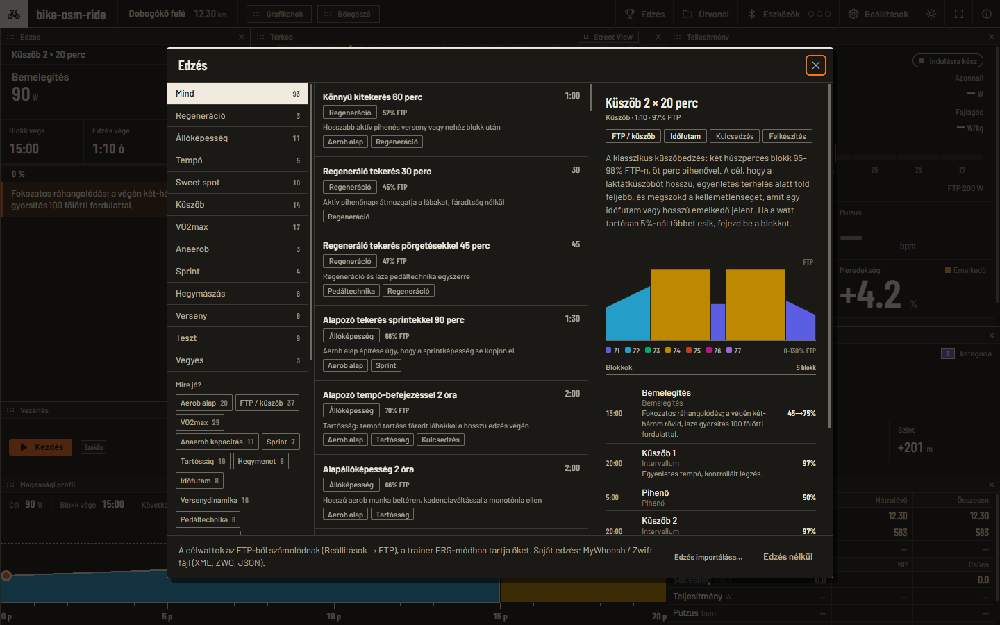

- Bal oldalt kategóriák és **címkék** (mire jó, szint, jelleg, időszak; ÉS-kapcsolatban szűkítenek, mellettük a
  találatszám), középen a lista, jobbra a leírás (mit, miért, hogyan), a **zónaszínes blokkvázlat** és a
  blokkonkénti lista idővel, célponttal, edzői instrukcióval.
- A célok **%FTP**-ből számolódnak: az FTP-t a *Beállítások → Kerékpáros* alatt add meg; ha módosítod, a hátralévő
  rész azonnal újraszámolódik.
- Tekerés közben a trainer **ERG-módban** tartja a célwattot, az *Edzés* kártya és a profil-panel *Edzés* nézete
  mutatja a blokkot, a hátralévő időt, a következő blokkot, és az **edzői üzenetet** (az edzés megfelelő pillanatában,
  12 másodpercig, csak ott, nem felugró üzenetként). A szünet/kilépés itt is semlegesre állítja a trainert.
- **Erősség menet közben.** Ha az edzés túl könnyű vagy túl nehéz, ±5 %-os lépésekben, **50–150 %** között állíthatod
  — a hátralévő blokkok céljait skálázza (a kijelzés és a trainer ugyanazt a számot kapja). *Desktopon* a *Vezérlés*
  ablak **−/+** léptetője, vagy ERG alatt a **`↑`/`↓` nyílbillentyű** (tartsd nyomva: lépénként megy). *Telefonon* a
  **Tekerés fülön** indított **felhúzás** (nehezebb) vagy **lehúzás** (könnyebb) állít az erősségen. Ha a fül görgethető,
  a gesztust a teljesítményértéknél kezdd, vagy használd a **−/+** gombokat. Az edzés kezdetén a képernyő
  széle felvillan (fent piros, lent zöld, egy-egy rövid felirattal), hogy a mozdulatra figyelj. A beállítás nem
  marad meg: minden menet 100 %-on indul, a kártyán pedig ott látszik, ha nem 100 %-on tekersz.
- **Az edzés végén.** Az utolsó blokk lejárta után a trainer a terep-szimulációra vált vissza (a program ezt kifejezetten
  kétszer is elküldi, mert némelyik firmware nem engedi el az ERG-et egyetlen írásra). Ha a trainer mégis tartaná az
  utolsó célwattnak, az *Edzés* kártyán (a „*Edzés kész*” mellett) lévő **„ERG ki”** gombbal újraküldheted a váltást.
- **Saját edzés:** az *Edzés importálása…* a MyWhoosh- vagy Zwift-fájlt (`.xml`, `.zwo`) és a MyWhoosh JSON-exportját is
  beolvassa; a `workouts/` mappába kerül, és onnantól ugyanúgy választható.
- Tekerés közben az edzés nem cserélhető.

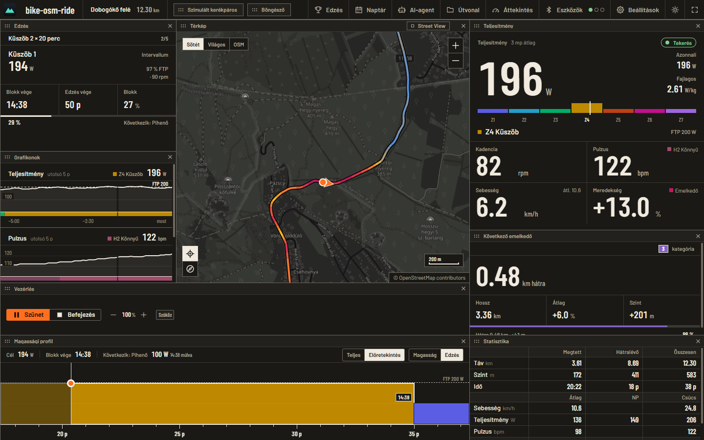

### Edzésnaptár és AI-agent

A felső sáv *Naptár* gombjával ütemezhetsz egy könyvtári edzést. Adj meg egy napot és szükség esetén kezdési
időpontot. A bejegyzést átteheted, törölheted, illetve előkészítheted a tekeréshez. Az előkészített edzés a
szokásos *Kezdés* gombbal indul. Ha még nincs betöltve útvonal, előbb az útvonalválasztó nyílik meg.
A naptár a korábbi napok mentett meneteit is mutatja, köztük azokat, amelyeket előzetes ütemezés nélkül végeztél.
A menethez tartozó elemzés közvetlenül a naptárból megnyitható.

Az *AI-agent* ablak a felső sáv robot ikonos *AI-agent* gombjával nyílik (1120 px-nél keskenyebb ablakban csak az ikon látszik), és elérhető a
*Naptárból*, a *Beállításokból*, a menet összegzéséből és az áttekintésből is. Itt kapcsolhatod be a helyi
agentkapcsolatot, kiválaszthatod a klienst (*Claude Code* vagy *JSON*, pl. Claude Desktop), és egy gombbal kimásolhatod
a hozzá tartozó beállítást; a nyers szöveg a *Nyers beállítás megjelenítése* alatt olvasható.

Az agent **edzőként** dolgozik: látja a naptárat (melyik edzés teljesült már, és melyik menettel), az utóbbi
menetek mutatóit, az általad megadott **RPE-t** (1–10) és azt, hogy a tervezett célokat mennyire tartottad
(teljesítési százalék). Ha egy korábbi edzés rosszul sikerült, a következőket személyre szabhatja: **új edzést vehet
fel, a még nem teljesített, ütemezett edzést áttehet, kicserélheti másikra, vagy törölheti**, minden módosításhoz
indoklást fűzve. A teljesített edzések múltnak számítanak, azokat az agent nem módosíthatja.

Semmi nem történik a jóváhagyásod nélkül: a beérkezett javaslat az *AI-agent* ablakban jelenik meg (a módosítás
előtte → utána formában, indoklással), és csak a *Jóváhagyás* gomb után kerül a naptárba. A befejezett, mentett menet
összegzéséből vagy az áttekintés menetnézetéből az *AI-elemzés* gombbal kimásolható az agentnek szóló kérés. Az agent
válasza javaslatként érkezik, amelyet jóváhagyás után a menetnél lehet visszaolvasni.

## Virtuális váltó

*Beállítások → Trainer → Virtuális váltó.* 2 × 12-es hajtás (50/34 és 11–34), **23 fokozat**. A `←`/`→` billentyűvel, a
Váltó panelen, telefonon a váltógombokkal vagy egy Zwift Click/Play kontrollerrel váltasz. Mivel egy okos trainernek
nincs váltója, a fokozat a trainerre küldött meredekséget módosítja (a legkönnyebb kb. −5 %, a legnehezebb kb. +5 %); a
panel a fokozat áttételét és a kadenciából adódó sebességet mutatja. **Edzés (ERG) közben a váltó nem látszik és nem hat**
(a célwatt a döntő). Zwift Click/Play kontrollernél az első léptetés bekapcsolja a váltót; a Click `+` gombja nehezebb,
`−` könnyebb irányba lép, a Play jobb kontrollerén a `Shift`/`Y`, a bal kontrolleren a `Shift`/`B` gomb (ez még
valódi kontrollerrel nem volt kipróbálva).

## Szellem és szegmensek

Minden befejezett menet **automatikusan elmentődik** az útvonalhoz (másodpercenkénti felvétel, összegzés, szegmensidők),
és ugyanezen az útvonalon a korábbi menet **szellemként** visszajátszható: már a rajt előtt a rajtvonalon vár, tekerés
közben a térképen és a profilon áttetsző jelölő mutatja, hol járt akkor, amikor te most; az előny/hátrány másodpercben
látszik. *Beállítások → Térkép és profil → Szellem*:

| Mód | Mit játszik vissza |
|---|---|
| Ki | semmit |
| Az útvonal ideje | a betöltött GPX saját időbélyegeit (Strava/Garmin-exportnál már az első menet előtt versenyezhetsz; a BRouter-útvonalakban nincs idő) |
| Legutóbbi menet | az útvonal legutóbbi menetét |
| Legjobb (PR) | a legkisebb idejű **teljes** menetet; ha még egy menet sem ért célba, a legtovább jutott (részleges) menetet, ami a saját végénél megáll |

A választó alatti sor megmondja, miért nincs éppen szellem. A felismert emelkedők **helyi szegmensek**: a rajt előtt a
legjobb idő (PR) látszik, benne tekerve a másodpercre mért különbség, az összegzésben a „korábbi PR” és az „Új PR!”
jelvény. A **szimulált tekerővel** tekert menet elmentődik, de nem lesz PR és nem lesz „Legjobb” szellem.

## Összegzés és TCX

Az útvonal végén (vagy a `Befejezés` után) az **összegzés** nyílik: távolság, idő, szint, átlag- és normalizált
teljesítmény, IF, TSS, energia, átlagsebesség, pulzus, a szegmenstábla és a teljesítmény- és pulzuszónák megoszlása.

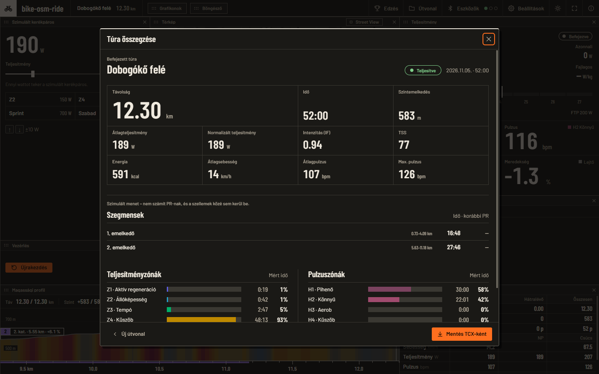

Alul a `Mentés FIT-ként` és a `Mentés TCX-ként` gomb (Garmin-formátumok; a javasolt fájlnév dátumból és útvonalnévből áll) és az
`Új útvonal`. A FIT-et a Strava, a Garmin Connect, a TrainingPeaks és az Intervals.icu is a legjobban olvassa; ha edzést tekertél,
annak lépései külön körként jelennek meg. Egy korábbi edzést az áttekintő oldal részletes nézetéből mentheted el utólag.

**Feltöltés Stravára, Intervals.icu-ra, TrainingPeaks-re:** beépített feltöltés nincs. A Strava saját oldalán a *Fájl feltöltése*
(Upload) menüben a mentett TCX-et kézzel is felviheted; az Intervals.icu és a TrainingPeaks is elfogadja. A 0.3.1-ig volt egy
háttérben futó feltöltő, de nálunk a bejelentkezés minden tekerés után újra kellett, ezért kivettük (0.3.2).

## Edzések áttekintése és összehasonlítása

Az **`Áttekintés`** gomb (felső sáv; telefonon a mérőóra ikon a téma-kapcsoló helyén, és az `Útvonal` ablak alján a
*Mentett edzések áttekintése* is) egy teljes képernyős oldalt nyit. Az `Esc` vagy a `Vissza` bezárja; alatta a tekerés
képernyője változatlanul marad. Telefonon a részek fülekre oszlanak (`Edzések`, `Térkép`, `Grafikon`, `Szakasz`), a
fejlécben a vissza nyíl, az **Összehasonlítás | Teljesítmény** váltó és az importálás ikonja.

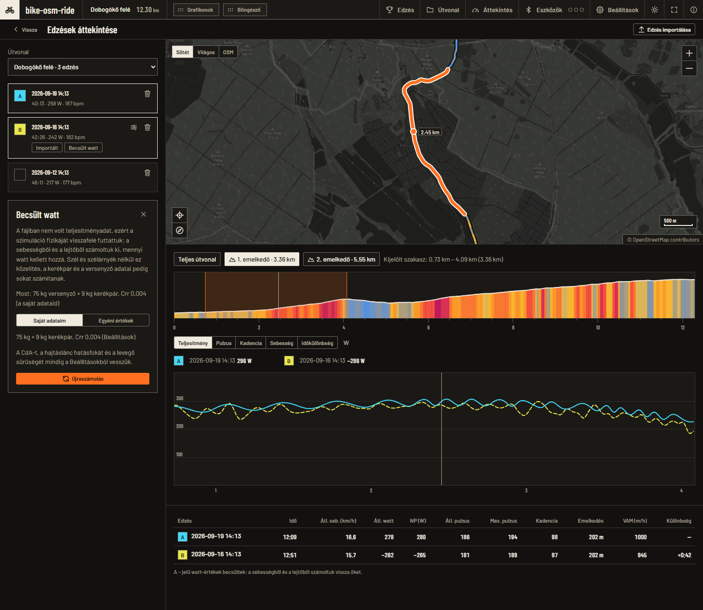

**Lista.** Balra az útvonal (a választóban minden útvonal, amelyen van mentett edzés, és a most betöltött) és az edzései,
legújabb elöl. Jelölj ki legfeljebb négyet: mindegyik kap egy betűt (A–D) és egy színt, a grafikonon a vonal mintája is
különbözik (az A folytonos). Az **A a viszonyítási edzés**: az *Időkülönbség* grafikon és a tábla *Különbség* oszlopa hozzá képest
értendő (pozitív = lassabb). A kuka megerősítést kér, mielőtt töröl. Alapból az útvonal két legújabb edzése van kijelölve.

**Grafikon.** *Teljesítmény*, *Pulzus*, *Kadencia*, *Sebesség* vagy *Időkülönbség* a távolság függvényében (telefonon a
gombokon a mértékegység áll: `W`, `bpm`, `rpm`, `km/h`, `±s`). Ha az egeret a profilon vagy a grafikonon mozgatod,
a kurzornál az edzések értéke a jelmagyarázatban olvasható, és a térképen egy pont jelzi a helyet; érintőképernyőn
**koppints** oda, és a kurzor ott marad. Kurzor nélkül a jelmagyarázat a látható szakasz átlagát mutatja (`Ø`; az
időkülönbségnél a szakasz végén mért különbséget). Ha egy edzésben nincs ilyen érzékelő (például pulzusmérő nélkül),
annak nincs vonala.

**Ráközelítés egy szakaszra.** Húzd végig az egeret a profilon vagy a grafikonon (érintőképernyőn **vízszintesen** az
ujjad; a függőleges húzás az oldalt görgeti), vagy kattints az *emelkedő* gombokra; a `Teljes útvonal` visszaállít. A
térkép a szakaszra közelít és kiemeli, a grafikon és a tábla ugyanarra a szakaszra szűkül. 100 m-nél rövidebb húzás nem
számít szakasznak.

**Szakasztábla.** Edzésenként: idő, átlagsebesség, átlag- és normalizált teljesítmény (NP, legalább 30 másodpercnyi adatból),
átlag- és maximális pulzus, kadencia, emelkedés, VAM és a különbség a viszonyítási edzéshez. Telefonon a tábla el van
forgatva: soronként egy szám, oszloponként egy edzés (A–D). Csak olyan szakaszra van adat, amelyet az edzés **teljesen
végigtekert**; egy részleges menet a többi szakaszon üres.

### Teljesítmény: forma, FTP, csúcsok, zónák, terhelés

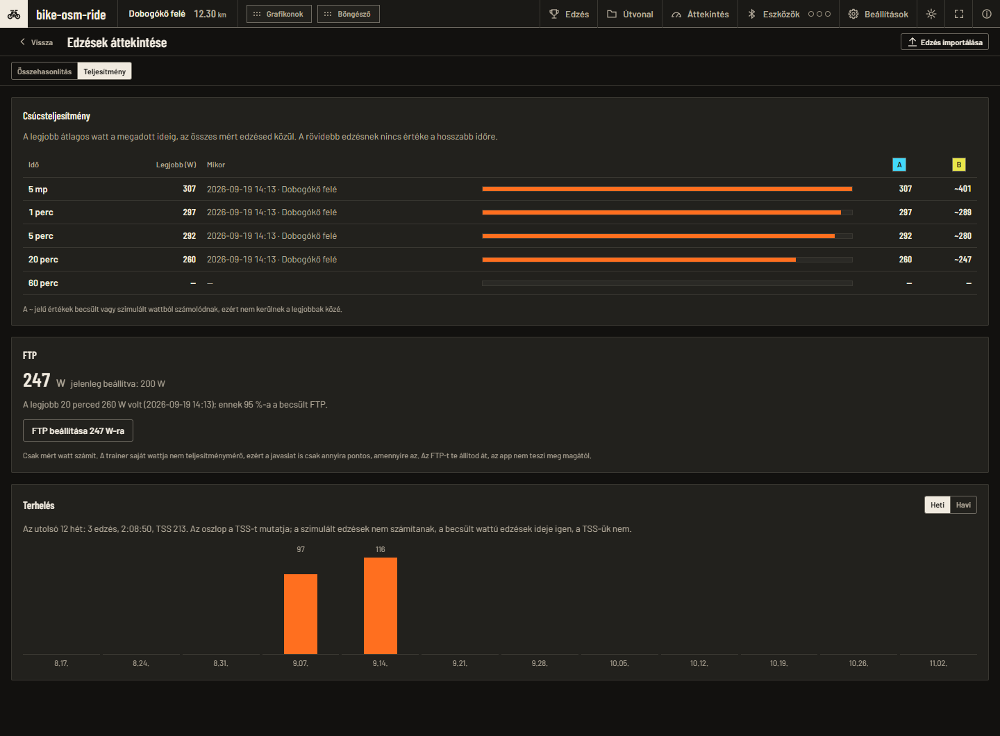

Az áttekintés tetején az **Összehasonlítás | Napló | Teljesítmény** váltó vált a nézetek között. A Teljesítmény oldalon az
**összes** edzésed számai vannak, útvonaltól függetlenül. Fent az **Időszak** (*28 nap*, *42 nap*, *90 nap*, *1 év*, *Mind*)
választja ki, mit mutasson a görbe, a zónák és a forma-grafikon; alapból 90 nap.

- **Forma és terhelés.** *Fitnesz (CTL)*: a napi terhelés 42 napos súlyozott átlaga. *Fáradtság (ATL)*: ugyanez 7 napra.
  *Forma (TSB)*: a kettő különbsége előző nap. Negatív forma: épp terhelsz; versenyre +5 és +25 között vagy friss. A *heti
  változás* azt mutatja, mennyit nőtt a fitnesz az elmúlt hét napban: ha hetente 5–8 pontnál gyorsabban nő, az
  túlterheléshez vezethet. A terhelés edzésenként: TSS mért wattból; ha nincs, **hrTSS** a pulzusból (egy óra a
  küszöbpulzuson 100); ha az sincs, a becsült watt TSS-e. A grafikon alatt az áll, hány edzés melyik forrásból számított.
- **FTP.** A javaslat mindig az **utolsó 90 nap** mért edzéseiből készül, így szünet vagy betegség után lefelé is követ. Az
  ERG-ben, előírt watton tekert szakaszok **nem számítanak**: amit egy edzés előírt, az nem mutatja meg, mit bírnál. A program a
  2–20 perces legjobbjaidra **CP-modellt** illeszt (kritikus teljesítmény és W′), és a mért legjobb 20 perc meg a modell 20 perce
  közül a nagyobbik 95 %-át javasolja. Így teszt nélkül is reális szám jön ki, ha volt néhány maximális rövidebb erőfeszítésed.
  Mellette W/kg, a jelenleg beállított FTP, és figyelmeztetés, ha a javaslat alacsonyabb a beállítottnál. Az **FTP beállítása N
  W-ra** gomb átírja a Beállításokban; magától az app soha nem módosítja. Alatta a *Becsült FTP hetente* (az utolsó 12 hét
  végén, mindegyik 90 napra visszanézve) és *Az FTP változásai* (milyen FTP-vel elemezték a meneteidet).
- **Pulzus.** A beállított maximum, küszöb (LTHR) és nyugalmi pulzus, a zónák alapja, és az időszak legmagasabb mért pulzusa.
  Ha az magasabb a beállított maximumnál, a **Maxpulzus beállítása** gomb átírja.
- **Csúcsteljesítmény.** A legjobb átlagos watt 1 másodperctől 90 percig, logaritmikus időtengelyen: a választott időszak (folytonos)
  és a mindenkori legjobb (szaggatott). A táblában a fontosabb időtartamok: watt, W/kg (a menet napi testsúlyával), mikor és hol
  (kattintásra megnyílik az a menet), a mindenkori legjobb, és ha az Összehasonlításban kijelöltél edzéseket, az ő értékeik (A–D).
- **Zónák.** Az időszak teljesítmény- és pulzuszónáinak ideje másodpercenként számolva, az arányokkal, és a könnyű (Z1–Z2) /
  közepes (Z3) / kemény (Z4+) megoszlás.
- **Terhelés.** Az utolsó 12 hét vagy hónap (*Heti* | *Havi*): az oszlop a teljes terhelés, a súgóban a TSS, a hrTSS és a becsült
  rész, az edzések száma, ideje és távja.

**Csak mért watt számít** a csúcsokba és az FTP-be. A szimulált tekerő és a becsült (`~`) wattú edzések kimaradnak (a becsült
watt csak a terhelésbe kerül, ha nincs pulzus). A trainer saját wattja nem teljesítménymérő, ezért az FTP-javaslat is csak
annyira pontos, mint az. A régebbi edzések számait az első megnyitáskor számoljuk ki újra és mentjük el; ez néhány másodpercig
tarthat sok edzésnél.

### Napló

A **Napló** az összes útvonal összes edzését mutatja időrendben, hetekre bontva (hétfőtől vasárnapig). Hetente: edzések
száma, idő, táv, terhelés és napi oszlopok (H–V). Soronként a dátum, az útvonal, az edzés neve (ha edzést tekertél), idő, táv,
NP (vagy átlagwatt), terhelés (`(pulzus)`: hrTSS, `~`: becsült watt), a megjegyzésed eleje és az érzet (RPE). Egy sorra
kattintva megnyílik az edzés részletes nézete. Alul a *Régebbi hetek* gomb tölt be továbbiakat.

### Egy edzés részletei

Megnyílik a Naplóból, az Összehasonlítás listájának **ⓘ** gombjából, vagy a csúcstábla dátumára kattintva. A *Vissza a
listához* zárja.

- **Számok**: idő, táv, átlagsebesség, átlagwatt, NP, IF, TSS (a menet napján beállított FTP-vel), hrTSS, **VI** (NP / átlagwatt:
  1,05 alatt egyenletes volt a tempó), **EF** (NP / átlagpulzus: ha ugyanolyan edzésen nő, fejlődsz), **Pw:HR szétcsúszás**
  (mennyivel nőtt a pulzus ugyanarra a wattra a második félben; 5 % alatt jó az aerob alap, legalább 20 perc kell hozzá), W/kg
  (átlag és NP), munka, munka FTP fölött, **W′ legalja** (a CP-modell szerint mennyi maradt a CP fölötti tartalékodból a
  legnehezebb pontján), pulzus, kadencia, az aznapi FTP és testsúly.
- **Grafikon** az **idő** függvényében: teljesítmény (edzésnél a **célwatt** vonalával), pulzus, kadencia, sebesség vagy
  **W′-egyenleg**.
- **Az edzés lépései**: ha edzést tekertél, lépésenként a cél, az átlagwatt, a **teljesítés %-ban** (a 90–110 %-on kívüli ki van
  emelve), NP, W/kg, pulzus, kadencia. Edzés nélkül a **kemény szakaszok**: a program magától megkeresi a legalább 1 perces
  szakaszokat, amelyeken a 30 másodperces átlag az FTP 88 %-a fölött maradt.
- **Zónák**: teljesítmény- és pulzuszónák másodpercenként, és a kadencia eloszlása.
- **Naplóbejegyzés**: az **érzet (RPE)** 1-től 10-ig és egy **megjegyzés** (alvás, étkezés, fájdalom, bármi). A *Bejegyzés
  mentése* elmenti; a Naplóban is látszik.
- **TCX** és **FIT** gomb: az edzés mentése fájlba, utólag is. A FIT-ben az edzés lépései külön körök (lap).

### Edzés importálása más alkalmazásból

Az **`Edzés importálása`** gombbal (vagy a fájlt az oldalra húzva) egy GPX-, TCX- vagy **FIT**-fájlt töltesz be, például egy Stravából,
Garminról vagy Wahoóról exportáltat. A pulzus, a kadencia és (ha van) a watt átjön. Tudnivalók:

- **Az útvonalat te adod meg**: az edzést arra az útvonalra illesztjük, amelyik az oldalon ki van választva (előbb töltsd be
  vagy válaszd ki). A nyom pontjait az útvonalra vetítjük; ami 30 m-nél messzebb esik tőle (kitérő, GPS-hiba), kimarad, és a
  kimaradtak számát az oldal kiírja. Ha az edzés az útvonalnak csak egy részét fedi le, figyelmeztet.
- Az **automatikus szünet** (hosszú megállás) nem számít az időbe. Időbélyeg nélküli fájl (például egy tervezett útvonal)
  nem importálható edzésként.
- Ugyanaz az edzés (ugyanaz a kezdési időpont) kétszer nem importálható.
- Az importált edzés **nem lesz PR és nem lesz szellem**: egy kinti menet megállásokkal és gurulással nem hasonlítható a
  görgős idejeidhez. A listában `Importált` címke jelzi.
- Telefonon az import még nem elérhető. A FIT-fájlból a pozíció nélküli pontok (beltéri edzés GPS nélkül) kimaradnak,
  mert az edzést az útvonalra a pozíció alapján illesztjük.

### Becsült watt

Ha a fájlban **nincs teljesítményadat**, a program a szimuláció fizikáját visszafelé futtatja: a sebességből és a lejtőből
kiszámolja, mennyi watt kellett hozzá (a mozgási energia változása és a gravitáció, a gördülés, a csapágy és a levegő elleni
munka egy 9 másodperces ablakban). Az ilyen edzésen a számok **`~`** jelet kapnak és `Becsült watt` címke látszik.

A csúszka-ikonnal (*A becslés beállításai*) megadhatod, kinek az adataival számoljon:

| Választás | Mit használ |
|---|---|
| **Saját adataim** | a Beállítások testsúlya, kerékpárja, Crr-je |
| **Egyéni értékek** | az itt megadott *testsúly*, *kerékpár* és *gördülési ellenállás (Crr)*, ha más edzését nézed |

A CdA-t, a hajtáslánc hatásfokát és a levegő sűrűségét mindig a Beállításokból vesszük. A Crr jó aszfalton kb. 0,004;
**kavicsos útra nincs külön modell**, ott csak a megadott Crr módosít. Az `Újraszámolás` új értékekkel számol, és elmenti az
edzést; a mért watt-ot a program soha nem írja felül becsléssel.

**Mennyire pontos?** Közelítés. Szelet és szélárnyékot nem ismer (a szembeszél kevesebb wattnak látszik), a lejtőt az útvonal
adja, nem a fájl zajos GPS-magassága, és éles kanyarokban a vetítés rövid ideig zajos sebességet adhat. A program saját
fizikájával visszafelé számolva a kört nagyjából 3 %-on belül adja vissza; valódi teljesítménymérővel még nem hasonlítottuk
össze, ezért 10–15 %-os eltéréssel érdemes számolni.

## Street View (opcionális)

A Google ezt csak az API-ján át engedi, ezért **saját Google Maps API-kulcs** kell (*Beállítások → Street View*; a
lépések ott le vannak írva: Google Cloud-projekt, számlázás, *Maps Embed API* és *Street View Static API* engedélyezése).
Kulcs nélkül nem jelenik meg semmi. A `V` vagy a térkép-panel `Street View` gombja kis ablakban hozza a térkép jobb
alsó sarkába; az `X` (vagy a cserélő gomb) a két nézetet felcseréli. Hibáknál érthető magyar üzenet jön (érvénytelen
kulcs, elfogyott kvóta, ezen a helyen nincs panoráma). A **Letöltés** gomb 75–250 méterenként egy képet ment az
útvonalhoz (legfeljebb kb. 900-at; 30 napig érvényes, a Beállításokban törölhető), így ugyanazt az utat legközelebb
kulcs és hálózat nélkül is végigtekered. A letöltés a saját Google-kvótádat használja. Részletek és a Google
szabályai: [`STREETVIEW.md`](STREETVIEW.md).

## Telefon és tablet

1000 px-nél keskenyebb ablakban füles nézet jelenik meg: alul **Tekerés · Térkép · Grafikonok · Adatok**, fölöttük a
nagy `Kezdés`/`Szünet`/`Befejezés` gombsor. A **Tekerés** fülön egy képernyőn van minden, ami tekerés közben kell: az
edzés blokkja (hátralévő idő, következő blokk, az edző üzenete), a teljesítmény a célhoz mérve (*célban / kevés / sok*), a
zónasáv, kadencia, pulzus, sebesség, meredekség, alatta a profil (oldalra húzva váltasz a nézetei között). A
párbeszédablakok telefonon teljes képernyősek. **Edzés alatt a Tekerés fülön fel-le húzással állíthatod az
erősséget**. Görgethető nézetben a teljesítményértéknél kezdd a gesztust. Az edzés kezdetén a képernyő széle felvillan.
Az útvonal vége után felül egy „*2. szakasz*” jelzés mutatja, hogy a folytatás melyik szakaszán jársz.

Nagyon kis kijelzőn (400 px-nél keskenyebben) a felső sáv **hamburger menüt** (≡) kap: az *Edzés*, a *Naptár*, az
*Eszközök* és a *Beállítások* a sávon marad, az *Útvonal*, az *Áttekintés* és az *AI-agent* a menüből nyílik. A menüt a
menün kívüli érintés vagy az `Esc` zárja be.

Telefonon minden gomb legalább 44 px magas. A `Befejezés` két lépésben működik: az első érintés pirosra váltja a gombot
(*Biztos?*), a második fejezi be a tekerést. Ha a telefont fektetve támasztod le, a `Szünet`/`Befejezés` gombok és a fülek a jobb
oldali sávba kerülnek, a fejegység és a profil egymás mellett van. Útvonal nélkül a Tekerés fülön az *Útvonal választása* gomb nyitja meg a választót.

  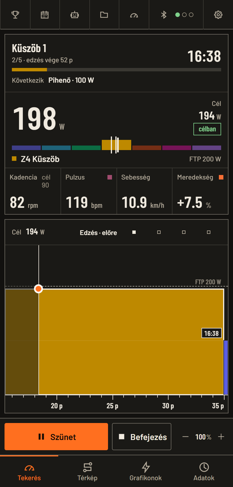
  &nbsp;&nbsp;
  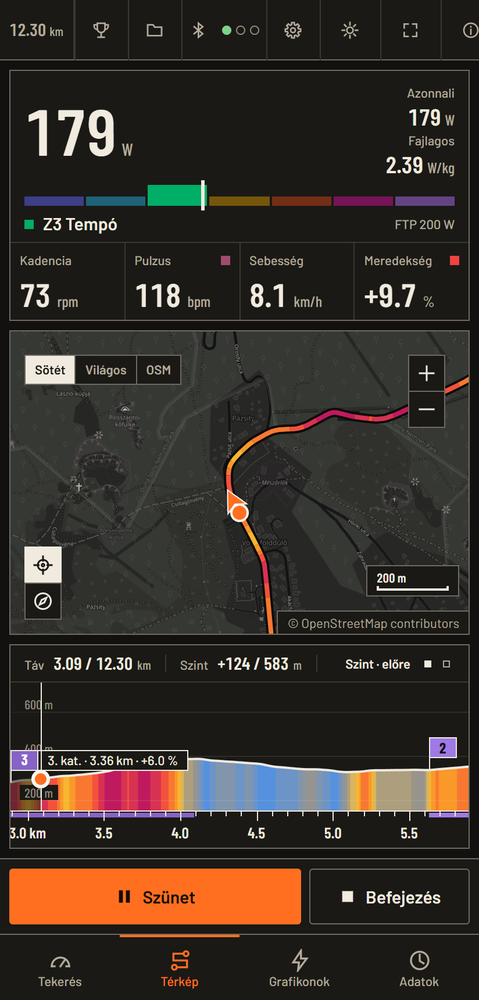

Az Android-alkalmazás ugyanez a program APK-ként. Útvonalat a rendszer fájlválasztójával, bikerouter-linkkel, a
legutóbbiak közül vagy a bemutató útvonallal töltesz be; az első indításkor a Bluetooth-engedélyeket kéri; a tekerés
alatt a képernyő bekapcsolva marad (szünetben és a túra végén a rendszer saját időkorlátja él újra; telefonon még nem
próbáltuk ki, [`ANDROID.md`](ANDROID.md)). Ha az alkalmazás hibát kap, egy piros sáv mutatja
az első sorát, és a program használható marad.

## Beállítások

Minden módosítás azonnal érvénybe lép és mentődik.

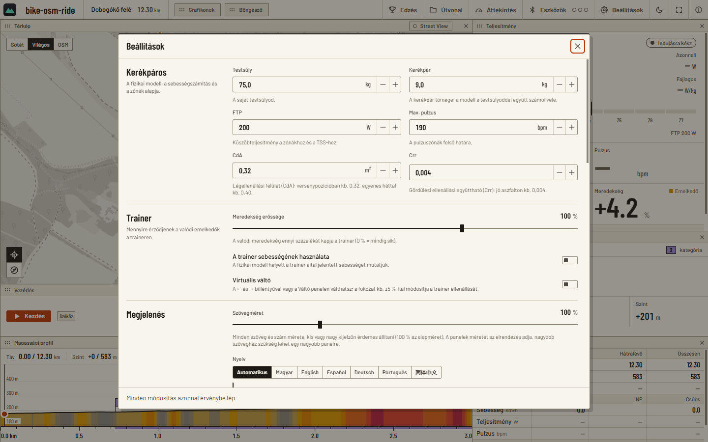

| Csoport | Mit állítasz |
|---|---|
| **Kerékpáros** | testsúly (75 kg), a bicikli súlya (9 kg), FTP (200 W), max. pulzus (190), nyugalmi pulzus (60), küszöbpulzus (LTHR; ha nem adod meg, a maximum 90 %-a), CdA (0,32 m²), Crr (0,004), a pulzuszónák alapja (*Max. pulzus*: a maximum 60/70/80/90 %-a; *Tartalék*: Karvonen; *LTHR*: Coggan) |
| **Trainer** | meredekség erőssége (0–150 %), a trainer sebességének használata, virtuális váltó |
| **Megjelenés** | nyelv (automatikus/magyar/angol/spanyol/portugál/német/olasz/kínai), szövegméret (80–160 %), téma (sötét/világos), térképstílus (sötét/világos/OSM) |
| **Térkép és profil** | a térkép kövesse a kerékpárost, profilnézet (előretekintés/teljes), előretekintés hossza, szellem |
| **Elrendezés** | az alaphelyzet visszaállítása |
| **Biztonsági mentés** | *Mentés fájlba* és *Visszaállítás fájlból* (lásd lent) |
| **Street View** | megjelenítés, a Google-kulcs, panoráma-azonosítók mentése, képek letöltése, a tárolt adatok törlése |
| **AI-agent** | az *AI-agent* ablak megnyitása (a helyi kapcsolat be- és kikapcsolása, a beérkezett javaslatok) |
| **Névjegy és licencek** | a program verziója, a felhasznált nyílt forráskódú részek licencei és az adatok forrásai (a felső sávon nincs külön gombja) |

### Biztonsági mentés

A *Mentés fájlba* egyetlen **zip-fájlt** készít az útvonalaidról, a mentett túráidról, az importált edzéseidről, a naptárról, az elfogadott AI-visszajelzésekről és a
beállításaidról. A fájlt te választod ki (Androidon a rendszer „Mentés másként” ablakával), és semmi nem megy ki a
hálózatra. **Nincs benne** a Street View-kulcs, a térképcsempék, a letöltött Street View-képek és a naplók: ezek
vagy titkok, vagy bármikor újra letölthetők.

A *Visszaállítás fájlból* **összefésül**: a mentés útvonalai, túrái és edzései hozzáadódnak a meglévőkhöz, **semmi nem
törlődik, és meglévő túra nem íródik felül**. A mentés beállításai viszont érvénybe lépnek (a Street View-kulcsod a régi
marad), ezért az app előbb rákérdez. Ugyanazt a fájlt kétszer visszaállítva nem történik semmi. Új gépre költözéskor
egyszerűen állítsd vissza a fájlt. Tekerés közben nem lehet mentést készíteni vagy visszaállítani; ha a fájl hibás vagy
újabb verzióból való, az app megmondja, és nem ír semmit. Androidon ez a rész telefonon még nem lett kipróbálva.

## Billentyűparancsok

| Gomb | Művelet |
|---|---|
| `Space` | indítás / szünet / folytatás (a végén az összegzés visszahozása) |
| `M` | térkép követő mód be/ki |
| `P` | magasságprofil: teljes ↔ előretekintő |
| `T` | sötét/világos téma |
| `V` | Street View panel be/ki |
| `X` | térkép és Street View cseréje |
| `W` | edzésválasztó |
| `←` / `→` | virtuális váltó: könnyebb / nehezebb |
| `↑` / `↓` | edzés alatt az **edzés erőssége** ±5 %; nélküle a szimulált tekerő teljesítménye ±10 W |
| `F11` | teljes képernyő |
| `Esc` | ablak bezárása, kilépés a teljes képernyőből |
| `Ctrl+O` | GPX megnyitása |

Szövegmezőben gépelve a gombok nem váltanak parancsot (kivéve `Esc`, `F11`, `Ctrl+O`); megnyitott ablaknál csak
`Esc`, `F11` és az Útvonal ablakban a `Ctrl+O` működik.

## Böngésző panel (csak Windows)

A **Böngésző** panel a gépre telepített **Firefoxot** építi be az ablakba, hogy sorozatot vagy bármit nézhess tekerés
közben. A Firefox saját profilt használ (a bejelentkezéseid megmaradnak, a rendes Firefoxodhoz nem nyúl). Macen és
Linuxon a panel nem jelenik meg. Ablak megnyitásakor vagy panelhúzáskor a Firefox ideiglenesen elrejtőzik (a natív
ablak fölé a felület nem tud rajzolni); a panel bezárása a Firefoxot is bezárja; legalább kb. 500 px széles legyen.

## Hibaelhárítás

| Tünet | Mit tegyél |
|---|---|
| A trainer nem reagál az emelkedőkre / az edzésre | Az **Eszközök** ablakban *Trainer* szerepben legyen csatlakoztatva (a teljesítménymérő szerep csak olvas). Nézd meg a BLE-naplót (`ble.log`, a [`BLUETOOTH.md`](BLUETOOTH.md) §11 szerint); Zwift vagy telefonos app ne tartsa a trainert. |
| **Az edzés után a trainer tartja az utolsó célwattnak** | A firmware nem engedte el az ERG-et. Nyomd meg az *Edzés* kártyán az **„ERG ki”** gombot; ha nem segít, a trainer saját gombján/kijelzőjén lépj ki az ERG-módból vagy indítsd újra a trainert, és küldd el nekünk a `ble.log`-ot. |
| Nem találja az eszközt | Kapcsold be a Bluetooth-t; Windowson a keresés szűrés nélküli, így sok eszköz látszik: nézd az eszköz szerepeit. Ha a listában **„Csatlakoztatva”** jelölésű sor van, azt másik alkalmazás vagy a telefon automatikus visszakapcsolása tartja: engedd el ott, vagy indítsd újra a trainert, és indíts új keresést. Androidon engedd a Bluetooth-engedélyeket (a *Keresés indítása* újra kérdez); macOS-en a rendszer az első kereséskor kér engedélyt. |
| A térkép üres vagy szürke | Nincs hálózat és még nincs gyorsítótárazott csempe: az útvonal és a számok így is működnek. |
| Az útvonal nem töltődik be | A hibaüzenet megmondja az okot (hibás fájl, nem támogatott link, nincs hálózat a BRouterhez). A linknek tartalmaznia kell a `lonlats=` részt. |
| A profil lapos | A fájlban nincs magasságadat, és az Open-Meteo sem volt elérhető. Tölts be magassággal ellátott GPX-et vagy bikerouter-linket. |
| Linuxon üres az ablak | A program magától beállítja a `WEBKIT_DISABLE_DMABUF_RENDERER=1` változót; ha így is üres, próbáld `WEBKIT_DISABLE_COMPOSITING_MODE=1`-gyel. |
| macOS: „nem nyitható meg” | Jobb klikk → Megnyitás → Megnyitás (az alkalmazás nincs hitelesítve); vagy `xattr -dr com.apple.quarantine /Applications/bike-osm-ride.app`. |
| Windows: ha a SmartScreen figyelmeztet | A program nincs digitálisan aláírva, ezért a Windows megállíthatja; a *További információ → Futtatás mindenképp* útján indítható. |
| Összeomlás / piros sáv | Az első sor a sávban van, a teljes napló a `crash.log`-ban (Androidon `adb logcat -s bike-osm-ride`). Kérlek, jelentsd a hibát a naplóval. |

**Hol vannak az adataim?** Egyetlen mappában, a beállításokkal, a tekerés-naplóval, a csempékkel és a naplókkal együtt
(ha másolatot akarsz, használd a *Beállítások → Biztonsági mentés* gombját):
Windows `%LOCALAPPDATA%\bike-osm-ride`, macOS `~/Library/Application Support/bike-osm-ride`, Linux
`~/.local/share/bike-osm-ride`, Android az alkalmazás privát mappája. A pontos felépítést a
[`ROUTES_AND_DATA.md`](ROUTES_AND_DATA.md) írja le; hogy mi megy ki a gépről, a [`PRIVACY.md`](PRIVACY.md).
