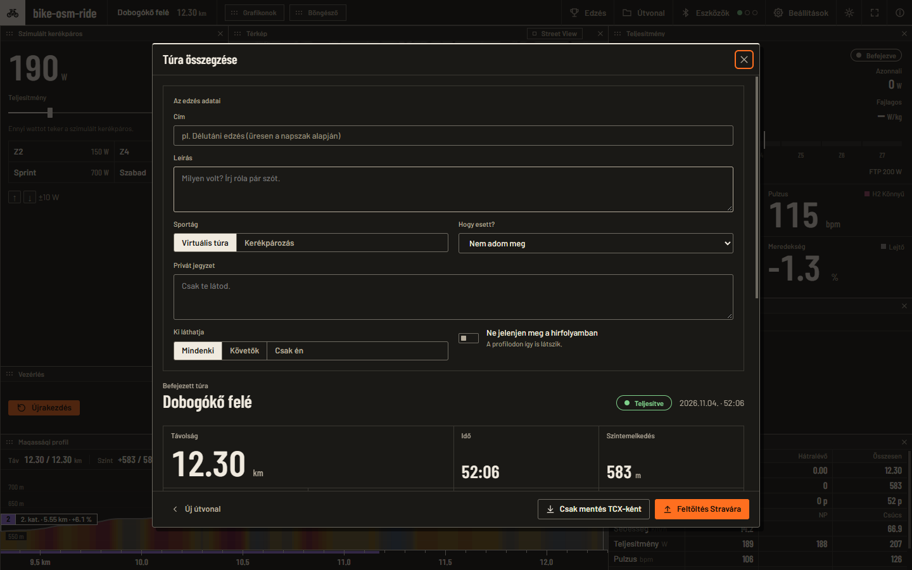

# Felhasználói kézikönyv

A bike-osm-ride használata az első indítástól a tekerés összegzéséig. A telepítés és a rövid áttekintés a
[README](../README.md)-ben van; a fejlesztői részletek az [`ARCHITECTURE.md`](ARCHITECTURE.md)-ben és társaiban.
A képernyőképek a 0.3.0-s verzióról készültek, a dokumentumban látható útvonal a BRouter egy valódi, a repóban
tesztadatként szereplő útvonala (© OpenStreetMap-közreműködők, ODbL).

**Tartalom:** [Első indítás](#első-indítás) · [Útvonal](#útvonal-betöltése) · [Eszközök](#eszközök-csatlakoztatása) ·
[Tekerés](#tekerés) · [A képernyő](#a-képernyő-és-az-elrendezés) · [Edzések](#edzések) ·
[Virtuális váltó](#virtuális-váltó) · [Szellem és PR](#szellem-és-szegmensek) ·
[Összegzés, TCX, Strava](#összegzés-tcx-és-strava) · [Street View](#street-view-opcionális) ·
[Telefon](#telefon-és-tablet) · [Beállítások](#beállítások) · [Billentyűk](#billentyűparancsok) ·
[Hibaelhárítás](#hibaelhárítás)

## Első indítás

Indításkor az **Útvonal** ablak nyílik meg az üres tekerés-képernyő fölött. Három út van a kezdéshez: GPX-fájl,
bikerouter-link vagy a bemutató útvonal. Hardver nélkül is végigtekerhetsz a **Szimulált tekerővel** (lásd
[Eszközök](#eszközök-csatlakoztatása)).

## Útvonal betöltése

- **GPX-fájl.** Tallózással (`GPX megnyitása`, `Ctrl+O`) vagy az ablakra húzva. Bármilyen GPX jó: a program a
  `<trk>`/`<trkseg>` pontokat használja (több szakaszt egymás után fűz), ennek hiányában az `<rte>` pontokat;
  ékezetes, BOM-os, névterekkel tarkított fájlt is megért; a hibás (levágott) fájlra érthető hibaüzenetet ad, nem
  rövidített útvonalat. A mérethatár 64 MB.
- **Bikerouter-link.** Tervezz útvonalat a [bikerouter.de](https://bikerouter.de)-n, kattints a *Megosztás* linkre, és
  másold a mezőbe (`Beillesztés`, majd `Útvonal betöltése`). A linkből a pontok, a profil, az alternatíva és az
  elkerülők is átkerülnek; az útvonalat a BRouter szervere számolja. A nyers BRouter-címek és a `lonlats=…`
  paraméterek is megfelelnek.
- **Bemutató útvonal.** Egy rövid, dombos budapesti kör a kipróbáláshoz (a koordinátái az utak *közelében* futnak,
  nem rajtuk).
- **Legutóbbi útvonalak.** Az utolsó 20, adatokkal (táv, szint, mikor nyitottad meg, forrás); a kuka törli a
  listából (a tekerés-napló megmarad).

Ha a GPX-ben nincs (használható) magasságadat, a program az Open-Meteo szolgáltatástól kéri el (a koordináták
mennek ki); ha ez sem sikerül, az útvonal lapos profillal töltődik be, és figyelmeztet. A fájlból:

- ha a fő track mellett van egy *rövidebb* track, amely az útvonalon fekszik (például egy beletett Strava-szegmens),
  vagy egy `<type>segment</type>` jelölésű track, az **szegmens** lesz: sávként látszik a profilon, tekerés közben
  „Szegmens: … X km hátra” kiírás jelzi (a Strava saját GPX-exportja nem tartalmaz szegmenst);
- ha *minden* ponthoz tartozik időbélyeg (Strava- vagy Garmin-export), az útvonal **a saját szelleme** is: lásd a
  [Szellem](#szellem-és-szegmensek) fejezetet.

A program az útvonalból **emelkedőket** keres: legalább 500 m hosszú, legalább 3 %-os átlagú, legalább 25 m szintet
nyerő szakaszok, 4-től HC-ig kategóriával (hossz × átlagos meredekség szerint).

## Eszközök csatlakoztatása

A felső sáv **Eszközök** gombja (mellette három pont mutatja, hány szerep csatlakozott). Öt szerep van:
**Trainer** (okos trainer, FTMS), **Pulzus**, **Teljesítménymérő** (CPS), **Cadence-szenzor** (CSC) és **Váltó**
(Zwift Click/Play).

1. `Keresés indítása`: a program szűrés nélkül keres, és a hirdetett szolgáltatások alapján sorolja be az eszközöket
   (a keresés 30 másodperc után magától leáll).
2. A talált eszköz mellett a szerepek gombjai: arra a szerepre csatlakoztatod, amelyre kell. Egy fizikai eszköz
   **egyszerre több szerepet** is elláthat: ha a trainered a teljesítményt, kadenciát vagy pulzust is sugározza, egyetlen
   kapcsolat tölti ki az összes kártyát (a kártyákon *közös eszköz* jelzés látszik). A szenzorok adatai közül a
   pontosabb forrás nyer (teljesítmény: teljesítménymérő a trainer előtt; kadencia: CSC, majd a teljesítménymérő, majd
   a trainer; pulzus: mellkasöv a trainer előtt).
3. Ami 3 másodperce nem frissült, az „—”-ra vált; megszakadt kapcsolatnál a program háromszor újrapróbálja.
4. **A trainert a Trainer szerepben csatlakoztasd**: a teljesítménymérő szerep csak olvas, a vezérlést (emelkedők,
   ERG) a Trainer szerep adja.
5. **Szimulált tekerő**: a lista első eleme, mindig ott van, Bluetooth nélkül is. A bal oldali panelen egy csúszkával
   (vagy `↑`/`↓`, ±10 W) adhatod meg a wattot, gyorsgombok: Z2 150 W, Z4 250 W, Sprint 700 W, Szabad 0 W. A kadencia és
   a pulzus hihetően követi.

**Hogyan vezérli a trainert?** Emelkedőn a trainer az előtted lévő szakasz meredekségét kapja (kb. 5–45 m előre,
simítva, legfeljebb ±20 %-ig, a *Meredekség erőssége* beállítással 0–150 %-ra skálázva). Szünetnél és a végén a
trainer lapos, semleges ellenállásra áll. Edzésnél (ERG) a célwattot tartja. A trainer *biztonsági szűrőn* át kapja
a parancsokat: csak a szükséges műveletek mennek ki, a célok a trainer saját tartományára vannak vágva.

> **Fontos, őszintén.** Az ERG-vezérlést egy valódi trainerrel (VE200) kipróbáltuk, az emelkedők szimulációját
> valódi trainerrel még nem igazoltuk, a Zwift Click/Play kontrollert, a külön pulzusmérőt és teljesítménymérőt
> valódi eszközzel még nem próbáltuk. A részletek: [`TESTING.md`](TESTING.md).

## Tekerés

`Kezdés` (vagy `Szóköz`) indítja a tekerést, `Szünet` megállítja (az idő is áll), `Befejezés` lezárja. Az útvonal végén a
tekerés **magától véget ér**. Kezdés előtt a profilra kattintva az útvonal bármely pontjára ugorhatsz; tekerés közben ez
nem megy. A program ébren tartja a gépet, amíg tekersz (Windows, Linux, macOS; Androidon nem).

A sebesség a mért **wattból** jön, a közúti mérésekkel validált Martin-féle modellel (gravitáció, gördülés,
csapágysúrlódás, légellenállás küllőkkel, tehetetlenség), a testsúlyodból, a bicikli súlyából, a CdA-ból és a Crr-ből;
a *trainer sebességének használata* kapcsolóval a trainer saját sebességét is használhatod. Részletek:
[`SIMULATION.md`](SIMULATION.md).

## A képernyő és az elrendezés

A tekerés-képernyő **panelekből** áll: *Térkép*, *Teljesítmény* (a nagy szám, 3 mp-es átlag, W/kg, zóna), *Következő
emelkedő*, *Statisztika*, *Magassági profil*, *Vezérlés*, *Grafikonok*, *Edzés*, *Szimulált kerékpáros*, *Váltó*,
*Böngésző*. Úgy működnek, mint egy tiling ablakkezelőben: **nincs átfedés és nincs lyuk.**

- **Átméretezés:** az elválasztót húzva (a vonal egy 96 × 64-es rács celláira ugrik, a panelek minimális méretét
  tiszteletben tartva; csak a két szomszédos panel változik).
- **Mozgatás:** a panel fejlécénél fogva egy másik panel *szélére* ejtve kettéosztja azt, a *közepére* ejtve helyet
  cserélnek (szellemkeret mutatja, mi lesz).
- **Bezárás:** a panel × gombja; a szomszédja kitölti a helyét, a panel *chipként* a felső sávba kerül. A chipre
  kattintva oda tér vissza, ahol volt; a felületre húzva oda, ahová ejted.
- **Minden mentődik.** *Beállítások → Elrendezés → Elrendezés visszaállítása* az alaphelyzetet hozza vissza.
- Az elrendezést (és a profil nézetét) a program **külön jegyzi edzéssel és edzés nélkül**: a kiválasztott edzéshez
  saját elrendezés tartozik, amely addig a szabadot követi, amíg ott nem alakítod át.

**Térkép.** A térkép a standard OpenStreetMap-csempéket mutatja; a *Sötét* és *Világos* stílus helyben szűri őket,
az *OSM* az eredeti. Görgővel nagyítasz az egér körül, húzással tologatod; a bal alsó gombokkal követő módba
és középre állítod (`M`). Az útvonal színe az emelkedőt jelzi (hideg: lejtő, szürke: sík, sárga–narancs–piros–bíbor:
egyre meredekebb emelkedő), a bringás a nyíllal jelölt korong. Alul az OSM-hivatkozás és a méretarány.

**Magassági profil.** `Teljes` (az egész útvonal) vagy `Előretekintés` (a következő ~3 km; hossza a beállításokban
állítható, `P`); az emelkedők zászlóként a kategóriával, a km-beosztás alul; kattintásra ugrás (tekerés előtt),
egérre adatkiolvasás. Az előretekintő skála csak akkor vált, ha muszáj. Ha van kiválasztott edzés, a **Magasság |
Edzés** kapcsoló az edzés blokkjait mutatja.

**Szövegméret.** *Beállítások → Megjelenés → Szövegméret* (80–160 %).

## Edzések

A felső sáv **Edzés** gombja (vagy `W`). A beépített könyvtár **93 edzés**, 12 kategóriában (regeneráció, állóképesség,
tempó, sweet spot, küszöb, VO2max, anaerob, sprint, hegymászás, verseny, teszt, vegyes), köztük 20 és 8 perces FTP-teszt,
ramp- és CP-tesztek, és sok, publikált kutatás protokollját követő ülés (Rønnestad 30/15, Seiler 4 × 8, Helgerud 4 × 4,
Billat 30/30, Gibala sprintintervallum és mások; a források edzésenként a `workouts.json` `sources` mezőjében).

- Bal oldalt kategóriák és **címkék** (mire jó, szint, jelleg, időszak; ÉS-kapcsolatban szűkítenek, mellettük a
  találatszám), középen a lista, jobbra a leírás (mit, miért, hogyan), a **zónaszínes blokkvázlat** és a
  blokkonkénti lista idővel, célponttal, edzői instrukcióval.
- A célok **%FTP**-ből számolódnak: az FTP-t a *Beállítások → Kerékpáros* alatt add meg; ha módosítod, a hátralévő
  rész azonnal újraszámolódik.
- Tekerés közben a trainer **ERG-módban** tartja a célwattot, az *Edzés* kártya és a profil-panel *Edzés* nézete
  mutatja a blokkot, a hátralévő időt, a következő blokkot, és az **edzői üzenetet** (az edzés megfelelő pillanatában,
  12 másodpercig, csak ott, nem felugró üzenetként). A szünet/kilépés itt is semlegesre állítja a trainert.
- **Saját edzés:** az *Edzés importálása…* a MyWhoosh- vagy Zwift-fájlt (`.xml`, `.zwo`) és a MyWhoosh JSON-exportját is
  beolvassa; a `workouts/` mappába kerül, és onnantól ugyanúgy választható.
- Tekerés közben az edzés nem cserélhető.

## Virtuális váltó

*Beállítások → Trainer → Virtuális váltó.* 2 × 12-es hajtás (50/34 és 11–34), **23 fokozat**. A `←`/`→` billentyűvel, a
Váltó panelen, telefonon a váltógombokkal vagy egy Zwift Click/Play kontrollerrel váltasz. Mivel egy okos trainernek
nincs váltója, a fokozat a trainerre küldött meredekséget módosítja (a legkönnyebb kb. −5 %, a legnehezebb kb. +5 %); a
panel a fokozat áttételét és a kadenciából adódó sebességet mutatja. **Edzés (ERG) közben a váltó nem látszik és nem hat**
(a célwatt a döntő). Zwift Click/Play kontrollernél az első léptetés bekapcsolja a váltót; a Click `+` gombja nehezebb,
`−` könnyebb irányba lép, a Play jobb kontrollerén a `Shift`/`Y`, a bal kontrolleren a `Shift`/`B` gomb (ez még
valódi kontrollerrel nem volt kipróbálva).

## Szellem és szegmensek

Minden befejezett menet **automatikusan elmentődik** az útvonalhoz (másodpercenkénti felvétel, összegzés, szegmensidők),
és ugyanezen az útvonalon a korábbi menet **szellemként** visszajátszható: már a rajt előtt a rajtvonalon vár, tekerés
közben a térképen és a profilon áttetsző jelölő mutatja, hol járt akkor, amikor te most; az előny/hátrány másodpercben
látszik. *Beállítások → Térkép és profil → Szellem*:

| Mód | Mit játszik vissza |
|---|---|
| Ki | semmit |
| Az útvonal ideje | a betöltött GPX saját időbélyegeit (Strava/Garmin-exportnál már az első menet előtt versenyezhetsz; a BRouter-útvonalakban nincs idő) |
| Legutóbbi menet | az útvonal legutóbbi menetét |
| Legjobb (PR) | a legkisebb idejű **teljes** menetet; ha még egy menet sem ért célba, a legtovább jutott (részleges) menetet, ami a saját végénél megáll |

A választó alatti sor megmondja, miért nincs éppen szellem. A felismert emelkedők **helyi szegmensek**: a rajt előtt a
legjobb idő (PR) látszik, benne tekerve a másodpercre mért különbség, az összegzésben a „korábbi PR” és az „Új PR!”
jelvény. A **szimulált tekerővel** tekert menet elmentődik, de nem lesz PR és nem lesz „Legjobb” szellem.

## Összegzés, TCX és Strava

Az útvonal végén (vagy a `Befejezés` után) az **összegzés** nyílik: távolság, idő, szint, átlag- és normalizált
teljesítmény, IF, TSS, energia, átlagsebesség, pulzus, a szegmenstábla és a teljesítmény- és pulzuszónák megoszlása.

Fölötte kitöltheted, amit a Strava is kér: cím (üresen a napszakból lesz, pl. „Délutáni edzés”), leírás, **virtuális
túra** vagy sima kerékpározás, hogy esett, privát jegyzet, ki láthatja, hírfolyam-némítás.

Alul két gomb: `Csak mentés TCX-ként` (Garmin-séma, Strava/Intervals.icu/TrainingPeaks-kompatibilis fájl, a javasolt
fájlnév dátumból és útvonalnévből áll) és `Feltöltés Stravára`.

- **Asztali gépen** a feltöltés a háttérben megy a Strava saját feltöltő oldalán át (API-kulcs és Strava-előfizetés
  nem kell). Egyszer be kell jelentkezned (a program a jelszavadat nem látja, a belépés megmarad), utána egy rejtett ablak
  tölti fel a túrát a megadott adatokkal. Ha a Strava oldala megváltozott és valami nem megy, az ablak megjelenik, a TCX-másolat
  pedig a `strava` mappában marad. **Ezt még soha nem próbáltuk ki a valódi Stravával** ([`STRAVA.md`](STRAVA.md)).
- **Androidon** a gomb a Strava appnak adja át a TCX-et (Android 10+); a címet és a többit ott kell megadni.

## Street View (opcionális)

A Google ezt csak az API-ján át engedi, ezért **saját Google Maps API-kulcs** kell (*Beállítások → Street View*; a
lépések ott le vannak írva: Google Cloud-projekt, számlázás, *Maps Embed API* és *Street View Static API* engedélyezése).
Kulcs nélkül nem jelenik meg semmi. A `V` vagy a térkép-panel `Street View` gombja kis ablakban hozza a térkép jobb
alsó sarkába; az `X` (vagy a cserélő gomb) a két nézetet felcseréli. Hibáknál érthető magyar üzenet jön (érvénytelen
kulcs, elfogyott kvóta, ezen a helyen nincs panoráma). A **Letöltés** gomb 75–250 méterenként egy képet ment az
útvonalhoz (legfeljebb kb. 900-at; 30 napig érvényes, a Beállításokban törölhető), így ugyanazt az utat legközelebb
kulcs és hálózat nélkül is végigtekered. A letöltés a saját Google-kvótádat használja. Részletek és a Google
szabályai: [`STREETVIEW.md`](STREETVIEW.md).

## Telefon és tablet

1000 px-nél keskenyebb ablakban füles nézet jelenik meg: alul **Tekerés · Térkép · Grafikonok · Adatok**, fölöttük a
nagy `Kezdés`/`Szünet`/`Befejezés` gombsor. A **Tekerés** fülön egy képernyőn van minden, ami tekerés közben kell: az
edzés blokkja (hátralévő idő, következő blokk, az edző üzenete), a teljesítmény a célhoz mérve (*célban / kevés / sok*), a
zónasáv, kadencia, pulzus, sebesség, meredekség, alatta a profil (oldalra húzva váltasz a nézetei között). A
párbeszédablakok telefonon teljes képernyősek.

  
  &nbsp;&nbsp;
  

Az Android-alkalmazás ugyanez a program APK-ként. Útvonalat a rendszer fájlválasztójával, bikerouter-linkkel, a
legutóbbiak közül vagy a bemutató útvonallal töltesz be; az első indításkor a Bluetooth-engedélyeket kéri; a tekerés
alatt a képernyő időkorlátja érvényes lehet ([`ANDROID.md`](ANDROID.md)). Ha az alkalmazás hibát kap, egy piros sáv mutatja
az első sorát, és a program használható marad.

## Beállítások

Minden módosítás azonnal érvénybe lép és mentődik.

| Csoport | Mit állítasz |
|---|---|
| **Kerékpáros** | testsúly (75 kg), a bicikli súlya (9 kg), FTP (200 W), max. pulzus (190), CdA (0,32 m²), Crr (0,004) |
| **Trainer** | meredekség erőssége (0–150 %), a trainer sebességének használata, virtuális váltó |
| **Megjelenés** | szövegméret (80–160 %), téma (sötét/világos), térképstílus (sötét/világos/OSM) |
| **Térkép és profil** | a térkép kövesse a kerékpárost, profilnézet (előretekintés/teljes), előretekintés hossza, szellem |
| **Elrendezés** | az alaphelyzet visszaállítása |
| **Street View** | megjelenítés, a Google-kulcs, panoráma-azonosítók mentése, képek letöltése, a tárolt adatok törlése |

## Billentyűparancsok

| Gomb | Művelet |
|---|---|
| `Space` | indítás / szünet / folytatás (a végén az összegzés visszahozása) |
| `M` | térkép követő mód be/ki |
| `P` | magasságprofil: teljes ↔ előretekintő |
| `T` | sötét/világos téma |
| `V` | Street View panel be/ki |
| `X` | térkép és Street View cseréje |
| `W` | edzésválasztó |
| `←` / `→` | virtuális váltó: könnyebb / nehezebb |
| `↑` / `↓` | a szimulált tekerő teljesítménye ±10 W |
| `F11` | teljes képernyő |
| `Esc` | ablak bezárása, kilépés a teljes képernyőből |
| `Ctrl+O` | GPX megnyitása |

Szövegmezőben gépelve a gombok nem váltanak parancsot (kivéve `Esc`, `F11`, `Ctrl+O`); megnyitott ablaknál csak
`Esc`, `F11` és az Útvonal ablakban a `Ctrl+O` működik.

## Böngésző panel (csak Windows)

A **Böngésző** panel a gépre telepített **Firefoxot** építi be az ablakba, hogy sorozatot vagy bármit nézhess tekerés
közben. A Firefox saját profilt használ (a bejelentkezéseid megmaradnak, a rendes Firefoxodhoz nem nyúl). Macen és
Linuxon a panel nem jelenik meg. Ablak megnyitásakor vagy panelhúzáskor a Firefox ideiglenesen elrejtőzik (a natív
ablak fölé a felület nem tud rajzolni); a panel bezárása a Firefoxot is bezárja; legalább kb. 500 px széles legyen.

## Hibaelhárítás

| Tünet | Mit tegyél |
|---|---|
| A trainer nem reagál az emelkedőkre / az edzésre | Az **Eszközök** ablakban *Trainer* szerepben legyen csatlakoztatva (a teljesítménymérő szerep csak olvas). Nézd meg a BLE-naplót (`ble.log`, a [`BLUETOOTH.md`](BLUETOOTH.md) §11 szerint); Zwift vagy telefonos app ne tartsa a trainert. |
| Nem találja az eszközt | Kapcsold be a Bluetooth-t; Windowson a keresés szűrés nélküli, így sok eszköz látszik: nézd az eszköz szerepeit. Androidon engedd a Bluetooth-engedélyeket (a *Keresés indítása* újra kérdez); macOS-en a rendszer az első kereséskor kér engedélyt. |
| A térkép üres vagy szürke | Nincs hálózat és még nincs gyorsítótárazott csempe: az útvonal és a számok így is működnek. |
| Az útvonal nem töltődik be | A hibaüzenet megmondja az okot (hibás fájl, nem támogatott link, nincs hálózat a BRouterhez). A linknek tartalmaznia kell a `lonlats=` részt. |
| A profil lapos | A fájlban nincs magasságadat, és az Open-Meteo sem volt elérhető. Tölts be magassággal ellátott GPX-et vagy bikerouter-linket. |
| Linuxon üres az ablak | A program magától beállítja a `WEBKIT_DISABLE_DMABUF_RENDERER=1` változót; ha így is üres, próbáld `WEBKIT_DISABLE_COMPOSITING_MODE=1`-gyel. |
| macOS: „nem nyitható meg” | Jobb klikk → Megnyitás → Megnyitás (az alkalmazás nincs hitelesítve); vagy `xattr -dr com.apple.quarantine /Applications/bike-osm-ride.app`. |
| Windows: ha a SmartScreen figyelmeztet | A program nincs digitálisan aláírva, ezért a Windows megállíthatja; a *További információ → Futtatás mindenképp* útján indítható. |
| Összeomlás / piros sáv | Az első sor a sávban van, a teljes napló a `crash.log`-ban (Androidon `adb logcat -s bike-osm-ride`). Kérlek, jelentsd a hibát a naplóval. |
| A Strava-feltöltés elakadt | A megjelenő ablakban fejezd be kézzel, vagy töltsd fel a `strava` mappában maradt TCX-et; a hiba nyoma a `strava-debug.log`. |

**Hol vannak az adataim?** Egyetlen mappában, a beállításokkal, a tekerés-naplóval, a csempékkel és a naplókkal együtt:
Windows `%LOCALAPPDATA%\bike-osm-ride`, macOS `~/Library/Application Support/bike-osm-ride`, Linux
`~/.local/share/bike-osm-ride`, Android az alkalmazás privát mappája. A pontos felépítést a
[`ROUTES_AND_DATA.md`](ROUTES_AND_DATA.md) írja le; hogy mi megy ki a gépről, a [`PRIVACY.md`](PRIVACY.md).
