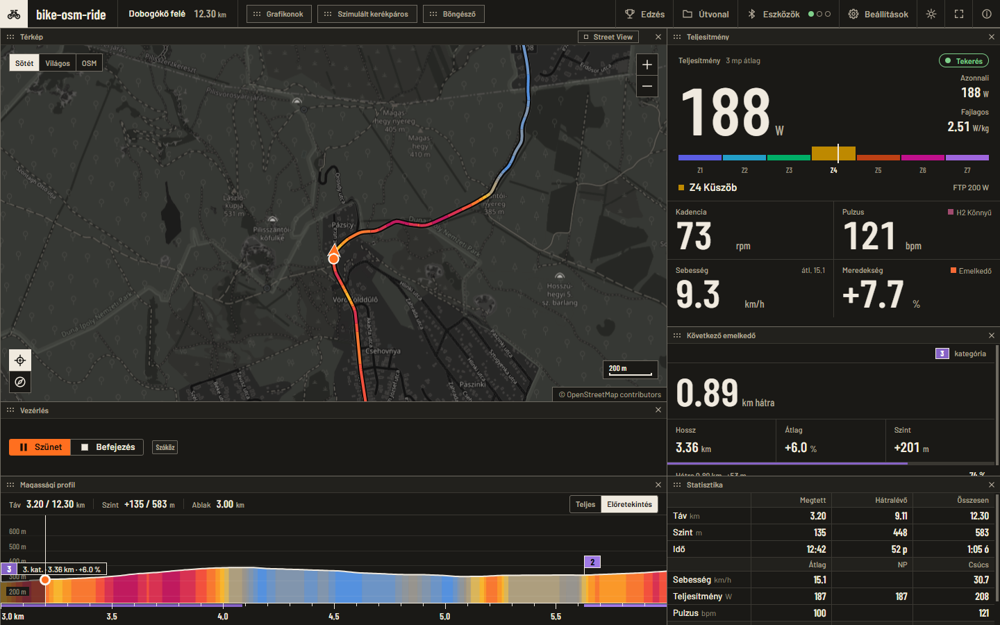
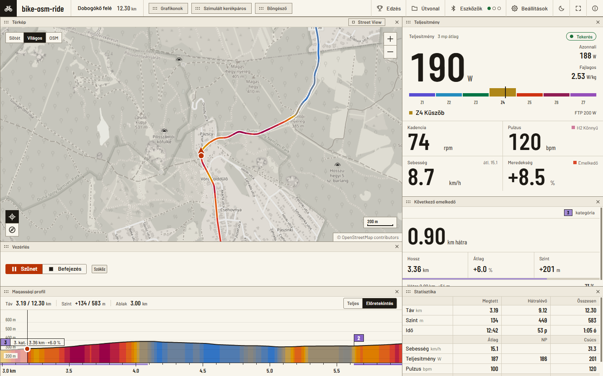
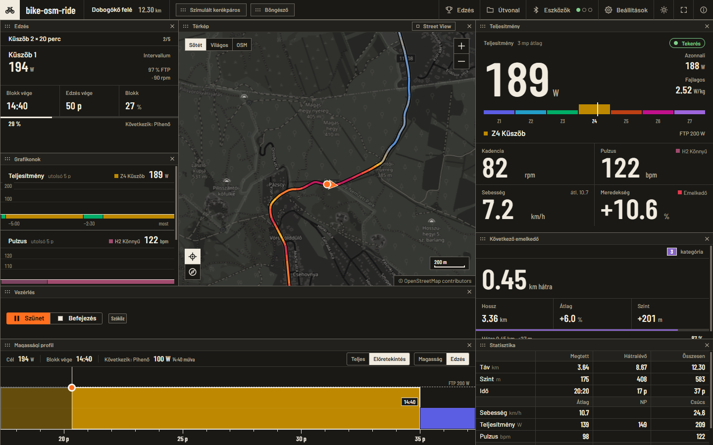
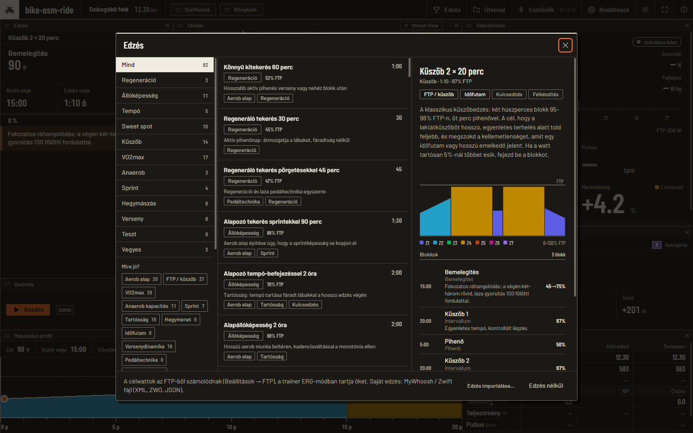
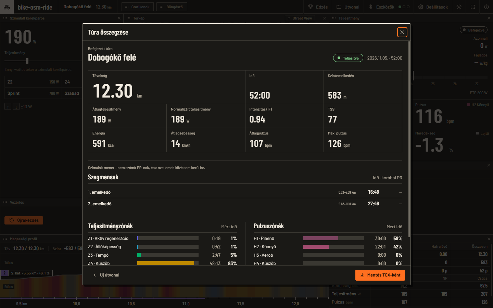
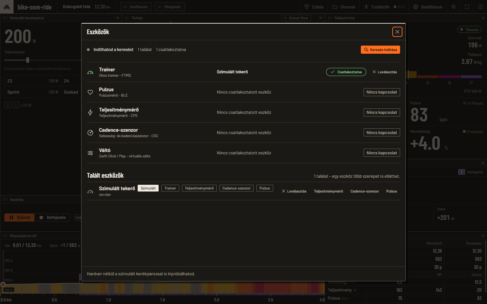
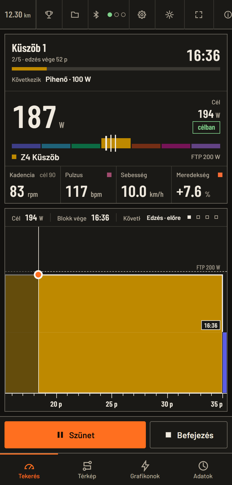
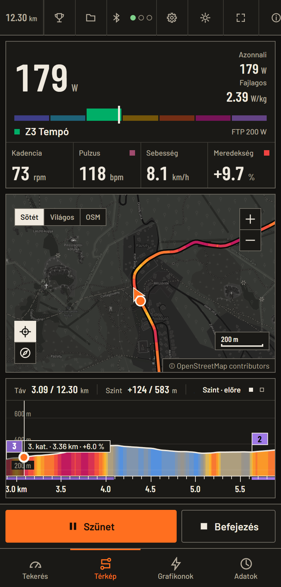
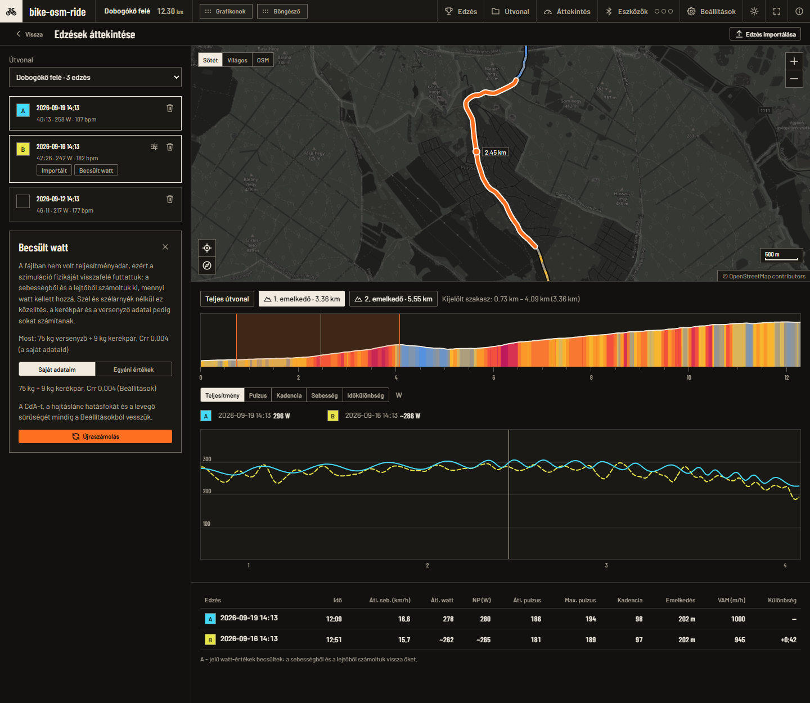
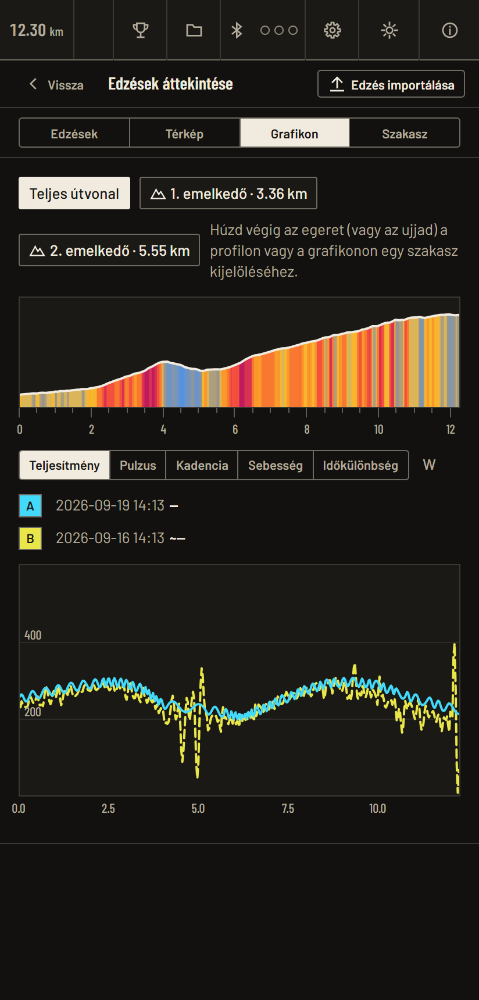

# bike-osm-ride — auf Deutsch

> **Übersetzung.** Maßgeblich ist die ungarische Fassung dieses Dokuments: [`README.md`](../../../README.md).
> Die Screenshots zeigen die ursprüngliche (ungarische) Oberfläche; die App spricht Ungarisch, Englisch, Spanisch und Deutsch.
> Handbuch und Datenschutzerklärung gibt es ebenfalls auf Deutsch: [Benutzerhandbuch](USER_GUIDE.md) ·
> [Datenschutz](PRIVACY.md).

**Sprache:** [Ungarisch](../../../README.md) · [Englisch](../en/README.md) · [Spanisch](../es/README.md) · Deutsch

<p align="center">
  
</p>

<p align="center">
  <b>Virtuelles Fahren auf deinen eigenen GPX-Routen, mit Smart-Trainer – oder ohne.</b><br>
  Karte, Höhenprofil, Workouts, Geist, TCX-Export. Schnell, modern, 2D. Rust.
</p>

<p align="center">
  <a href="https://github.com/pirelike/bike-osm-ride/releases/latest"></a>
  
  
  
  
</p>

<p align="center">
  
</p>

**Springe zu:** [Download](#download) · [Schnellstart](#schnellstart) · [Was sie kann](#was-sie-kann) · [Screenshots](#screenshots) ·
[Geräte und Stand](#geräte-und-stand) · [Dokumentation](#dokumentation) · [Entwicklung](#entwicklung) · [Lizenz](#lizenz)

## Warum?

- **Deine Route.** Keine vorgebaute Welt: Du fährst jede GPX-Datei oder jeden bikerouter-Link, mit echter Höhe und echten Anstiegen,
  und der Trainer folgt der Steigung der Route.
- **Jede Zahl, die zählt.** Leistung (3-s-Schnitt, W/kg, Zone), Trittfrequenz, Puls, Tempo, Steigung,
  NP/IF/TSS, Höhenmeter, voraussichtliche Ankunft: in großen, lesbaren Zahlen, ohne 3D.
- **Workouts und Analyse.** 93 eingebaute Workouts mit Quellen, im ERG-Modus, mit Coach-Nachrichten; Geist und lokale
  Abschnitte mit PR; TCX-Export.
- **Es bleibt deins.** Kein Konto, keine Telemetrie, deine Daten liegen auf deinem Rechner ([Datenschutz](PRIVACY.md)). Open
  Source, unter einer permissiven Lizenz.
- **Es funktioniert ohne Hardware.** Mit dem simulierten Fahrer probierst du alles ohne Bluetooth.

## Download

Die neueste Version: **[Releases → Latest](https://github.com/pirelike/bike-osm-ride/releases/latest)**.
In den Dateinamen ist `<version>` die Versionsnummer (zum Beispiel `0.3.0`).

| Plattform | Datei | Installation |
|---|---|---|
| **Windows 10/11** | `bike-osm-ride-<version>-windows-x64.exe` | kein Installer: einfach starten. Es braucht die [WebView2-Runtime](https://developer.microsoft.com/microsoft-edge/webview2/) (Windows 11 hat sie standardmäßig). Das Programm ist nicht digital signiert, deshalb kann SmartScreen es stoppen. |
| **Linux** (x86-64, glibc 2.35+) | `bike-osm-ride-<version>-linux-x86_64.AppImage` | `chmod +x`, dann starten; WebKitGTK und GTK bringt es mit |
| | `bike-osm-ride-<version>-linux-amd64.deb` | `sudo apt install ./bike-osm-ride-<version>-linux-amd64.deb` (es verlangt die Pakete `libwebkit2gtk-4.1-0`, `libgtk-3-0`, `bluez`) |
| **macOS 11+** (Intel und Apple Silicon) | `bike-osm-ride-<version>-macos-universal.dmg` | in den Ordner *Programme* ziehen; beim ersten Start **Rechtsklick → Öffnen → Öffnen** (es ist nicht notarisiert); beim ersten Bluetooth-Scan Bluetooth erlauben |
| **Android 7+** | `bike-osm-ride-<version>-android.apk` | auf das Telefon kopieren und öffnen (Installation aus unbekannten Quellen erlauben) oder `adb install -r` |

Das Programm **meldet sich**, wenn es eine neue Version gibt: Die Schaltfläche *Update* erscheint in der oberen Leiste (unter Windows und
als AppImage ersetzt sie sich selbst, auf den anderen Plattformen öffnet sie die Release-Seite). Das Android-Paket ist mit einem
Debug-Schlüssel signiert, deshalb musst du zwischen zwei Versionen vielleicht zuerst die alte deinstallieren.

## Schnellstart

1. **Starten.** Das Fenster *Route* öffnet sich: Zieh eine GPX-Datei hinein, füge einen bikerouter-Link ein oder wähle die
   *Demo-Route*.
2. **Trainer verbinden** (*Geräte* → *Scan starten* → in der Rolle *Trainer*), oder wähle den
   **simulierten Fahrer**, wenn keine Hardware zur Hand ist. Ein Pulssensor, ein Leistungsmesser, ein Trittfrequenzsensor und ein Zwift Click/Play lassen
   sich ebenfalls verbinden.
3. *(Optional)* **Workout**: die Schaltfläche *Workout* in der oberen Leiste (`W`), wähle aus 93 Workouts, oder importiere dein eigenes.
4. **`Start`** (`Leertaste`). Der Trainer folgt den Anstiegen (oder hält die Zielwatt des Workouts), und die Zahlen werden lebendig.
5. Am Ende speicherst du eine TCX-Datei aus der **Zusammenfassung** (Strava, Intervals.icu und TrainingPeaks akzeptieren sie).

Die vollständige Beschreibung: **[Benutzerhandbuch](USER_GUIDE.md)**.

## Was sie kann

**Routen**
- GPX-Datei (auswählen, hineinziehen, `Strg+O`), bikerouter-/BRouter-Link (Profil, Alternative und Vermeidungen
  kommen mit), letzte Routen, eingebaute Demo-Route.
- Toleranter GPX-Leser (BOM, Namensräume, mehrere Segmente, `<rte>`, verständliche Meldung bei beschädigter Datei); fehlende
  Höhe wird von Open-Meteo ergänzt. Anstiegserkennung von der 4. Kategorie bis HC; im File enthaltene Abschnittsspuren (zum
  Beispiel ein Strava-Abschnitt) erscheinen als Bänder.

**Fahren**
- Realistische Physik (Martin et al. 1998: Schwerkraft, Rollwiderstand, Lagerreibung, Luftwiderstand mit Speichen, Trägheit);
  der Trainer bekommt die Steigung des vor dir liegenden Abschnitts (bis ±20 %, mit einer Stärke von 0–150 %).
- **FTMS-Trainer** (Anstiege und ERG), **Leistungsmesser** (CPS), **Tempo/Trittfrequenz** (CSC), **Pulssensor** (HR); ein
  physisches Gerät kann *mehrere Rollen* in einer einzigen Verbindung erfüllen; **Zwift Click/Play** als virtuelle Schaltung; **simulierter Fahrer**.
- **Virtuelle Schaltung**: 2 × 12 Antrieb, 23 Gänge, verändert den Widerstand des Trainers.

**Workouts und Analyse**
- 93 eingebaute Workouts in 12 Kategorien, mit Tags, einem zonenfarbenen Blockdiagramm und 943 zeitgesteuerten Coach-Nachrichten; Import von
  MyWhoosh- und Zwift-Workouts (`.zwo`, XML, JSON).
- Coggan-Zonen, NP, IF, TSS, kcal; Herzfrequenzzonen; Aufzeichnung pro Sekunde.
- **Geist** (letzte Fahrt, beste, oder die eigenen Zeitstempel der GPX) und **lokale Abschnitte mit PR**.
- **Übersicht und Vergleich von Fahrten**: die Fahrten auf derselben Route (höchstens vier) nebeneinander nach Leistung, Puls,
  Trittfrequenz, Tempo und Zeitdifferenz; Zoomen in einen Abschnitt (durch Ziehen oder aus den Anstiegen), Abschnittstabelle.
  **Import einer GPX- oder TCX-Fahrt** aus einem Strava- oder Garmin-Export, mit Puls und Trittfrequenz; fehlen die Watt, schätzt
  die Physik der Simulation sie rückwärts (mit deinem oder dem angegebenen Körpergewicht, Rad und Rollwiderstand).
- **Leistungsseite**: Spitzenleistung von 5 s bis 60 Minuten, ein FTP-Vorschlag aus deinen besten 20 Minuten (mit einer
  Schaltfläche übernehmbar), wöchentliche und monatliche Belastung. Nur gemessene Watt zählen.
- **Sicherung**: die Routen, die Fahrten, die importierten Workouts und die Einstellungen in einer einzigen Zip-Datei (ohne den Google-Schlüssel),
  mit zusammenführender Wiederherstellung. Nichts geht ins Netz.
- **TCX-Export** (Garmin-Schema): Strava, Intervals.icu und TrainingPeaks akzeptieren die Datei, wenn du sie von Hand hochlädst. Einen
  eingebauten Upload gibt es nicht: Die Strava-Anmeldung wäre nach jeder Fahrt zu wiederholen gewesen, deshalb haben wir sie entfernt (0.3.2).

**Oberfläche**
- **Kachel-Layout**: Die Panels arbeiten wie in einem Kachel-Fenstermanager (keine Überlappung, keine Lücken); sie lassen sich vergrößern, verschieben
  und durch Ziehen schließen; ein eigenes Layout mit und ohne Workout.
- Dunkles und helles Design (beide vollwertig), Textgröße 80–160 %, **ungarische, englische, spanische und deutsche Oberfläche**
  (*Einstellungen → Erscheinungsbild → Sprache*, oder automatisch der Systemsprache folgend), eingebaute Schriften.
- **Telefon und Tablet**: eine Ansicht mit Tabs; der Tab „Fahrt“ hat alles, was du beim Fahren brauchst.
- Optionales **Street View** (mit deinem eigenen Google-Schlüssel, Offline-Download) und ein **Browser-Panel** (Windows, bettet das
  installierte Firefox ein).
- Hält den Rechner wach, während du fährst (Windows, Linux, macOS).

## Screenshots

<table>
  <tr>
    <td width="50%"><br><sub><b>Helles Design</b>: Das papierweiße Design steht gleichberechtigt neben dem dunklen</sub></td>
    <td><br><sub><b>Workout im ERG-Modus</b>: Workout-Karte, Live-Diagramme, Blockdiagramm</sub></td>
  </tr>
  <tr>
    <td><br><sub><b>93 Workouts</b> mit Filtern und einem zonenfarbenen Blockdiagramm</sub></td>
    <td><br><sub><b>Zusammenfassung</b>: NP, IF, TSS, Abschnitte, Zonen; TCX-Export</sub></td>
  </tr>
  <tr>
    <td><br><sub><b>Geräte</b>: ein Gerät in mehreren Rollen</sub></td>
    <td align="center">
      
      <br>
      <sub><b>Auf dem Telefon</b>: Tabs Fahrt und Karte</sub>
    </td>
  </tr>
  <tr>
    <td><br><sub><b>Übersicht</b>: zwei Fahrten an einem Anstieg, die zweite mit geschätzten Watt</sub></td>
    <td align="center">
      
      <br><sub><b>Auf dem Telefon</b>: Tabs Fahrten, Karte, Diagramm, Abschnitt</sub>
    </td>
  </tr>
</table>

<sub>Die Screenshots zeigen eine echte BRouter-Route (die letzten 12 km der Route Hűvösvölgy–Dobogókő, die im Repository
als Testdatei liegt), mit dem simulierten Fahrer. Route und Karte: © OpenStreetMap-Mitwirkende, ODbL. Die Bilder erzeugt
`node scripts/readme_shots.mjs`.</sub>

## Geräte und Stand

**Nicht jeder Punkt wurde mit echter Hardware oder einem echten Dienst versucht.** Ehrlich gesagt:

| Punkt | Stand |
|---|---|
| FTMS-Smart-Trainer, **ERG** (Workout) | getestet, **auch mit einem echten Trainer** (ein Modell: VE200) |
| FTMS-**Anstiegssimulation** | gründlich getestet (mit einem simulierten Transport, anhand der Byte-Vektoren der Spezifikation); **mit einem echten Trainer noch nicht bestätigt** |
| Pulssensor, separater Leistungsmesser, CSC-Sensor | die Decoder sind getestet; die CPS-/CSC-Daten des Trainers sind echt; mit einem separaten Sensor noch nicht versucht |
| Zwift Click / Play | implementiert (inoffiziell), mit einem echten Controller noch nicht versucht |
| Simulierter Fahrer | funktioniert ohne Hardware, auf jeder Plattform |
| Windows | im täglichen Einsatz |
| Linux, macOS | CI baut sie und (unter Linux) fährt einen 20-Sekunden-Smoke-Test; noch keine Prüfung auf echter Hardware (Erfahrungen willkommen) |
| Android | die Oberfläche ist gelaufen (die Fehler von 0.3.0 wurden beim Laufen gefunden); der System-Dateiauswähler ist implementiert; **Bluetooth wurde noch nicht auf einem Gerät versucht** |
| Street View | implementiert und mit einem lokalen Testserver geprüft; mit dem echten Dienst noch nicht versucht |

Details: [`docs/TESTING.md`](../../TESTING.md) und [`docs/BLUETOOTH.md`](../../BLUETOOTH.md). Fehlerberichte,
Erfahrungen und kompatible oder inkompatible Geräte sammeln wir gern in den Issues (das `ble.log` beizulegen lohnt sich).

## Dokumentation

| Für | Was |
|---|---|
| **Anwender** | [Benutzerhandbuch](USER_GUIDE.md) · [Datenschutz und Netzwerkverkehr](PRIVACY.md) · [Änderungsprotokoll](../../../CHANGELOG.md) · [Ungarisch](../../../README.md) · [Englisch](../en/README.md) |
| **Entwickler** | [Architektur](../../ARCHITECTURE.md) · [Entwicklungsleitfaden](../../DEVELOPMENT.md) · [Tests](../../TESTING.md) · [Veröffentlichung](../../RELEASING.md) · [Entscheidungslog](../../DECISIONS.md) · [Übersetzungen (i18n)](../../I18N.md) |
| **Themen** | [Bluetooth](../../BLUETOOTH.md) · [Simulation und Physik](../../SIMULATION.md) · [Routen und Datenformate](../../ROUTES_AND_DATA.md) · [Oberfläche](../../UI.md) · [Designsystem](../../DESIGN.md) · [Android](../../ANDROID.md) · [Street View](../../STREETVIEW.md) · [Vorarbeiten und übernommener Code](../../PRIOR_ART.md) |

Die vollständige Übersicht: [`docs/README.md`](../../README.md).

## Entwicklung

```powershell
cargo run -p ride-app                      # Debug-Build und Start (Windows, Linux, macOS)
cargo test --workspace                     # die vollständige Testsuite (2026-11-06: 1076 Tests)
node scripts/readme_shots.mjs              # die Screenshots neu erzeugen
```

Rust-Workspace mit zehn Bibliotheks-Crates und der Anwendung (`ride-app`):

```
crates/
  ride-model         gemeinsames Datenmodell (Route, Settings, RideSnapshot, Workout, …) – der „Vertrag“
  ride-route         GPX/bikerouter → Route, Anstiege, Persistenz, Fahrtenbuch
  ride-sim           Physik, RideEngine, Workout-Runner, Geist, Abschnitte, TCX (ohne I/O und Uhr)
  ride-ble           BLE-Hub (FTMS/CPS/CSC/HR/Zwift) + simulierter Fahrer
  ride-ui-kit        Designsystem: Tokens, Palette, Symbole, Formatierung
  ride-ui-map        Kachelkarte · ride-ui-profile  Profil und Diagramme
  ride-ui-hud        Instrumente, Karten, Steuerung       · ride-ui-dialogs  Dialoge
  ride-ui-streetview Street-View-Panel
  ride-app           die Hülle: Zustand, Controller, Kacheln, Tile-Proxy, Updater, Android
packaging/  scripts/  tests/fixtures/  docs/
```

Der Code baut auf Dioxus 0.7 (Webview-Oberfläche) und `btleplug` auf. Unter Windows entwickelt man auf dem
GNU-Toolchain (die Release-exe baut die CI mit MSVC). Voraussetzungen, Schalter (`RIDE_*`), Debugging, Paketierung:
[`docs/DEVELOPMENT.md`](../../DEVELOPMENT.md). Die Projektbeschreibung für Claude Code: [`CLAUDE.md`](../../../CLAUDE.md).

**Mitmachen.** Fehlerberichte, Messprotokolle und Patches sind willkommen. Die Regeln in Kürze: Nur Code mit permissiver
Lizenz darf übernommen werden (siehe unten), die Quellsprache der benutzersichtbaren Texte ist Ungarisch (jeder UI-Text ist ein Schlüssel in
`crates/ride-i18n/locales/hu.json`, mit den Übersetzungen daneben; siehe [`docs/I18N.md`](../../I18N.md)), bei externen Daten
geraten wir nicht in Panik, und ein neues Feature kommt mit Test und Dokumentation. Eingereichter Code kommt unter
der Lizenz des Projekts (MIT oder Apache-2.0) herein, sofern du nichts anderes sagst.

## Lizenz

### Der eigene Code des Projekts

Der Code von `bike-osm-ride` selbst ist **doppelt lizenziert: [MIT](../../../LICENSE-MIT) ODER [Apache-2.0](../../../LICENSE-APACHE)**,
nach deiner Wahl (SPDX: `MIT OR Apache-2.0`). Wenn du beiträgst, kommt der eingereichte Code unter denselben beiden Lizenzen
herein, sofern du nichts anderes sagst.

### Übernommener Open-Source-Code

Wir verwenden bewusst nur Code mit permissiver Lizenz. Herkunft und Lizenz bleiben in den Quelldateien und in
[`NOTICE.md`](../../../NOTICE.md) erhalten.

| Quelle | Lizenz | Wofür wir sie nutzen |
|---|---|---|
| [`ftms`](https://github.com/deancochran/ftms)-Crate | MIT | Kodieren und Dekodieren von Bluetooth-FTMS-Daten (Smart-Trainer) und Steuerbefehlen |
| [`cycling-ble`](https://github.com/friedrichwilken/cycling-ble) | Apache-2.0 OR MIT | Auswerten der Daten von Leistungsmesser, Trittfrequenz- und Pulssensor (eingebaut, in den Quelldateien gekennzeichnet) |
| [OsmolControl](https://github.com/Parapeth962/OsmolControl) | MIT | Trainerverbindung und Sicherheitsfilter für Befehle (übernommene Teile, gekennzeichnet) |
| [iron-heart](https://github.com/nullstalgia/iron-heart) | MIT | Suche nach dem Pulssensor und erneutes Verbinden (Muster übernommen, kein Code, gekennzeichnet) |
| [Barlow und Barlow Condensed](https://github.com/jpt/barlow)-Schriften | SIL OFL 1.1 | Text und Zahlen der Oberfläche; **in das Programm eingebaut** (subsetierte WOFF2, Latin + Latin Extended, Ungarisch abgedeckt), damit sie ohne Netz funktionieren; der Lizenztext: [`crates/ride-ui-kit/assets/fonts/OFL.txt`](../../../crates/ride-ui-kit/assets/fonts/OFL.txt), Details in [`NOTICE.md`](../../../NOTICE.md) |
| [virtual-cog](https://github.com/pymmog/virtual-cog) | Unlicense (Public Domain) | das BLE-Protokoll von Zwift Click/Play und Zwift Hub (in Rust neu geschrieben): das `zwift`-Modul von `ride-ble`, Details in [`NOTICE.md`](../../../NOTICE.md) |
| [`p256`](https://github.com/RustCrypto/elliptic-curves), [`hkdf`](https://github.com/RustCrypto/KDFs), [`sha2`](https://github.com/RustCrypto/hashes), [`aes`](https://github.com/RustCrypto/block-ciphers), [`ccm`](https://github.com/RustCrypto/AEADs) (RustCrypto) | MIT / Apache-2.0 | der Schlüsselaustausch des Zwift Click (ECDH P-256, HKDF-SHA256) und die AES-CCM-Verschlüsselung |
| [Mozilla Firefox](https://www.mozilla.org/firefox/) | MPL-2.0 (das Programm **enthält es nicht**, es startet die auf dem Rechner installierte Kopie) | das Browser-Panel: Das installierte Firefox-Fenster wird eingebettet, mit einem eigenen Profil |
| [Dioxus](https://dioxuslabs.com), [btleplug](https://github.com/deviceplug/btleplug), [tokio](https://tokio.rs), [quick-xml](https://github.com/tafia/quick-xml) und die übrigen Rust-Abhängigkeiten | überwiegend MIT / Apache-2.0 | die vollständige, automatisch erzeugte Liste (638 Pakete): [`THIRD_PARTY_LICENSES.md`](../../../THIRD_PARTY_LICENSES.md) |

Nur als **Referenz** diente (ohne Code zu übernehmen): ein Zahlenwert aus einem durchgerechneten Beispiel der Open-Source-
Martin-Implementierung `rouleur` im Physiktest, [`nrenner/brouter-web`](https://github.com/nrenner/brouter-web) (MIT)
zur Prüfung des bikerouter-Linkformats, und Makinolos Reverse-Engineering-Notizen zum Zwift-Click/Play-Protokoll als
Dokumentation: <https://www.makinolo.com/blog/2024/10/20/zwift-trainer-protocol/>. Das ist inoffizielle Interoperabilitäts-
arbeit: Wir haben keine Verbindung zu Zwift, das Programm ist kein Zwift-Produkt, und Zwift unterstützt es nicht.

Wir haben **keinen** Code aus GPL-/AGPL-lizenzierten Projekten verwendet (zum Beispiel OpenCycling, suffice, GoldenCheetah, QDomyos-Zwift),
weil das das ganze Programm unter Copyleft stellen würde; die Recherche-Details:
[`docs/PRIOR_ART.md`](../../PRIOR_ART.md).

**Lizenzaudit (2026-11-04, `cargo metadata --filter-platform`, normale und Build-Abhängigkeiten).** Die Zahl der externen
(crates.io-)Crates pro Plattform: Windows (GNU) 396, Linux 458, macOS (Apple Silicon) 400, Android (aarch64) 449. Darunter
gibt es **kein GPL, AGPL oder LGPL und keine unbekannte Lizenz**; die permissiven Lizenzen sind MIT, Apache-2.0, BSD, ISC, Zlib,
Unicode, CC0, Unlicense und ähnliche.

**Die einzige Copyleft-Art ist MPL-2.0**, und zwar **auf Dateiebene**, und wir nehmen die Crates unverändert von crates.io (kein
vendored Code); ihr Quellcode ist in den in [`THIRD_PARTY_LICENSES.md`](../../../THIRD_PARTY_LICENSES.md) genannten Repositories verfügbar:

- unter Linux und macOS `option-ext` (über die Kette `dioxus-desktop → tray-icon → dirs`);
- unter Android `selectors`, `cssparser`, `cssparser-macros` und `dtoa-short` (über die Kette `wry → kuchikiki`);
- unter Windows keine davon.

Das berührt die Lizenz des Projekts nicht: unser eigener Code bleibt `MIT OR Apache-2.0`. `Cargo.lock` enthält die Abhängigkeiten jeder
Plattform; die Liste neu erzeugen: `.\scripts\third_party_licenses.ps1`, die Audit-Befehle pro Plattform stehen
in Punkt 9 von [`docs/DEVELOPMENT.md`](../../DEVELOPMENT.md).

### Karten und Datenquellen (Quellenangabe)

Die Anwendung ruft im Betrieb externe Dienste auf; ihre Daten dürfen zu ihren eigenen Bedingungen genutzt werden, und die Anwendung
zeigt die nötigen Quellenangaben auf der Karte an (die vollständige Liste der Aufrufe: die [Datenschutzerklärung](PRIVACY.md)):

- **Kartendaten:** © [OpenStreetMap](https://www.openstreetmap.org/copyright)-Mitwirkende, [ODbL 1.0](https://opendatacommons.org/licenses/odbl/1-0/).
- **Kacheln:** die Standardkacheln von [OpenStreetMap](https://wiki.openstreetmap.org/wiki/Tiles) (`tile.openstreetmap.org`). Die Kartenstile *Dunkel* und
  *Hell* filtern dieselben Kacheln lokal (CSS-Filter), es braucht also keinen API-Schlüssel und keinen Style-Server eines Dritten.
  Heruntergeladene Kacheln werden lokal zwischengespeichert, um die Server zu schonen ([OSM Tile Usage Policy](https://operations.osmfoundation.org/policies/tiles/));
  ein Massen-Vorabladen gibt es nicht.
- **Street View (optional):** Dienste der [Google Maps Platform](https://mapsplatform.google.com): der *Metadaten*-Endpunkt der
  Street View Static API (nur JSON: Status, Panorama-ID, Position), der Bild-Endpunkt der Static API (nur für den von dir gewünschten Offline-
  Download) und die Street-View-Ansicht der Maps Embed API. Das Programm verwendet **deinen eigenen** API-Schlüssel (dein Google-Cloud-
  Konto, dein Kontingent und deine Abrechnung); der Schlüssel liegt nur auf deinem Rechner, in `settings.json`, wird nie protokolliert und nur an
  `maps.googleapis.com` / `www.google.com` gesendet. Es gelten die [Google Maps Platform-Bedingungen](https://cloud.google.com/maps-platform/terms) und die
  [Street-View-Richtlinien](https://developers.google.com/maps/documentation/streetview/policies). Das Programm
  **lädt Bilder nicht standardmäßig herunter**: Nur wenn du im Panel die Schaltfläche *Herunterladen* drückst, speichert es die Bilder der Route
  auf deinem Rechner für höchstens 30 Tage; es zeigt sie nur ohne Schlüssel oder bei einem Netzwerkfehler, ansonsten siehst du die Live-
  Ansicht in voller Auflösung. Die dauerhafte Speicherung von Street-View-Bildern ist durch Googles Bedingungen eingeschränkt, das ist also deine Entscheidung
  und Verantwortung; der Download nutzt das Kontingent deines eigenen Google-Kontos. Die Richtlinien erlauben das Speichern von *Panorama-IDs* (sie können sich
  mit der Zeit ändern, deshalb werden Koordinate und Zeitstempel daneben geführt, und die eingebettete Ansicht bekommt die Koordinate neben
  der ID). Dieses Programm ist kein Google-Produkt und hat keine Verbindung mit Google.
- **Workout-Beschreibungen:** Die eingebaute Workout-Bibliothek ist unser eigener Text, bearbeitet nach öffentlichen Trainingsprotokollen (British Cycling,
  TrainingPeaks, CTS, FasCat, TrainerRoad und andere) und trainingswissenschaftlichen Studien (Rønnestad, Seiler, Helgerud, Billat, Gibala,
  Bossi, Karsten und andere); die verwendeten Quellen stehen bei jedem Workout im Feld `sources` von
  `crates/ride-model/assets/workouts.json`.
- **Routenplanung:** [BRouter](https://brouter.de) / [bikerouter.de](https://bikerouter.de) (öffentlicher Dienst; wir rufen ihn nur auf, wenn du
  einen bikerouter-Link einfügst, und die Route berechnet ihr Server). Die Dateien `tests/fixtures/brouter_*.gpx` sind BRouter-
  Antworten aus OSM-Daten (ODbL), und dieselbe Route erscheint in den README-Screenshots.
- **Ergänzen fehlender Höhendaten (optional):** [Open-Meteo](https://open-meteo.com) Elevation API,
  [CC BY 4.0](https://creativecommons.org/licenses/by/4.0/), für nichtkommerzielle Nutzung.

Unsere eigene Lizenz erstreckt sich nicht auf diese Daten und diese Dienste.

### Rechtlicher Hinweis

Die Software wird „wie besehen“ bereitgestellt, ohne Gewährleistung; die Details stehen in den Dateien [LICENSE-MIT](../../../LICENSE-MIT) und
[LICENSE-APACHE](../../../LICENSE-APACHE). Die Gerätesteuerung (das automatische Anpassen des Widerstands am Trainer) erfolgt auf
eigene Gefahr.
