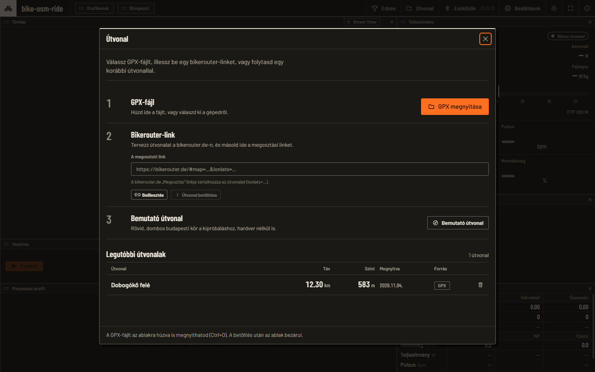
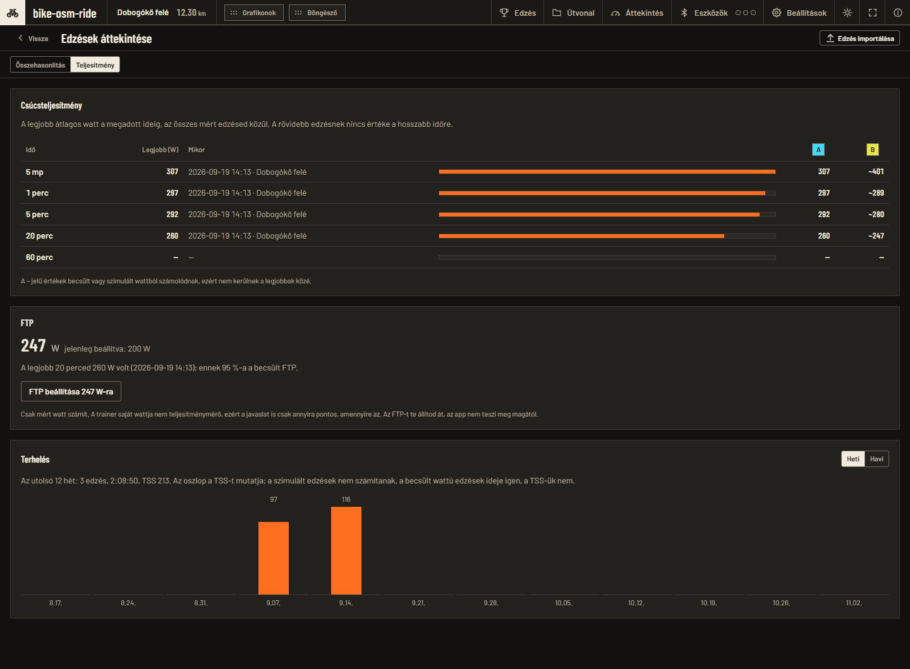
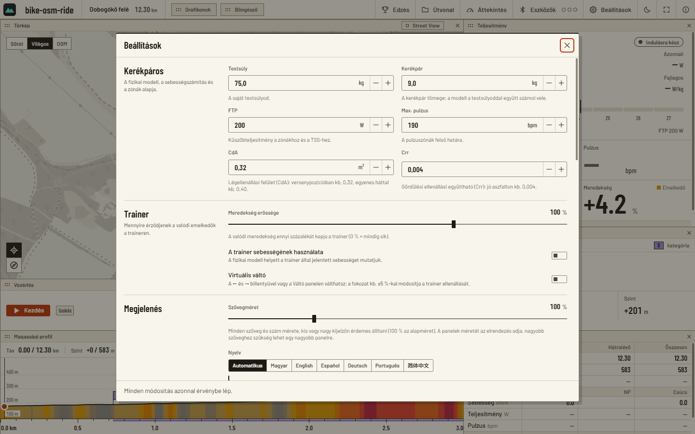

# Manual do utilizador

> **Tradução.** A versão autoritativa deste documento é o [manual do utilizador](../../USER_GUIDE.md) húngaro;
> está também disponível em [inglês](../en/USER_GUIDE.md) e [espanhol](../es/USER_GUIDE.md), e esta é a versão
> portuguesa. Podes mudar o idioma da interface em *Definições → Aspeto → Idioma*.

Como usar o bike-osm-ride desde o primeiro arranque até ao resumo da volta. A instalação e a visão geral curta estão no
[README](../../../README.md); os detalhes para programadores estão no [`ARCHITECTURE.md`](../../ARCHITECTURE.md) e nos
documentos que o acompanham. As capturas foram feitas na versão 0.3.0 e mostram a interface no seu idioma de origem, o
húngaro; a aplicação também fala inglês, espanhol e português. O percurso mostrado no documento é um percurso real do
BRouter que está no repositório como dado de teste (© colaboradores do OpenStreetMap, ODbL).

**Conteúdo:** [Primeiro arranque](#primeiro-arranque) · [Carregar um percurso](#carregar-um-percurso) ·
[Ligar dispositivos](#ligar-dispositivos) · [Pedalar](#pedalar) · [O ecrã e a disposição](#o-ecrã-e-a-disposição) ·
[Treinos](#treinos) · [Mudanças virtuais](#mudanças-virtuais) · [Fantasma e segmentos](#fantasma-e-segmentos) ·
[Resumo e TCX](#resumo-e-tcx) · [Street View](#street-view-opcional) ·
[Telemóvel e tablet](#telemóvel-e-tablet) · [Definições](#definições) · [Atalhos de teclado](#atalhos-de-teclado) ·
[Resolução de problemas](#resolução-de-problemas)

## Primeiro arranque

Ao arrancar, a janela **Percurso** abre por cima do ecrã de pedalada vazio. Há três formas de começar: um ficheiro GPX, um
link do bikerouter ou o percurso de demonstração. Sem hardware, também podes pedalar com o **Ciclista simulado** (ver
[Ligar dispositivos](#ligar-dispositivos)).

## Carregar um percurso

- **Ficheiro GPX.** Pelo seletor de ficheiros (`Abrir um GPX`, `Ctrl+O`) ou arrastando-o para a janela. Qualquer GPX serve: o programa usa
  os pontos `<trk>`/`<trkseg>` (vários segmentos são encadeados uns a seguir aos outros) e, se não houver nenhum, os pontos
  `<rte>`; também lê um ficheiro com acentos, com BOM e com espaços de nomes; para um ficheiro danificado (truncado) dá uma
  mensagem de erro compreensível, não um percurso encurtado. O limite de tamanho é 64 MB.
- **Link do bikerouter.** Planeia um percurso em [bikerouter.de](https://bikerouter.de), clica no link *Partilhar* e cola-o no
  campo (`Colar`, depois `Carregar um percurso`). Os pontos, o perfil, a alternativa e as zonas a evitar vêm todos
  do link; o percurso é calculado pelo servidor do BRouter. Os endereços do BRouter em bruto e os parâmetros `lonlats=…` também funcionam.
- **Percurso de demonstração.** Um pequeno circuito com colinas em Budapeste, para experimentar (as coordenadas passam *perto*
  das estradas, não por cima delas).
- **Percursos recentes.** Os últimos 20, com dados (distância, elevação, quando o abriste, origem); o caixote do lixo remove-o da
  lista (o registo de voltas mantém-se).

Se o GPX não tiver dados de elevação utilizáveis, o programa pede-os ao serviço Open-Meteo (as coordenadas são enviadas); se
isso também falhar, o percurso carrega com um perfil plano e avisa. Do ficheiro:

- se, além do traçado principal, houver um traçado *mais curto* que fique sobre o percurso (por exemplo, um segmento do Strava
  incorporado nele), ou um traçado marcado com `<type>segment</type>`, esse passa a ser um **segmento**: aparece como uma faixa no perfil e,
  durante uma volta, “Segmento: … X km por fazer” indica-o (a exportação GPX do próprio Strava não contém segmentos);
- se *todos* os pontos tiverem data/hora (uma exportação do Strava ou da Garmin), o percurso é **também o seu próprio fantasma**: vê o
  capítulo [Fantasma](#fantasma-e-segmentos).

O programa procura **subidas** no percurso: troços com pelo menos 500 m, com uma média de pelo menos 3% e que somem
pelo menos 25 m de desnível, com uma categoria da 4.ª a HC (por comprimento × declive médio).

## Ligar dispositivos

O botão **Dispositivos** na barra superior (os três pontos ao lado mostram quantas funções estão ligadas). Há cinco funções:
**Rolo** (rolo inteligente, FTMS), **Pulso**, **Potenciómetro** (CPS), **Sensor de cadência** (CSC) e **Manípulo**
(Zwift Click/Play).

1. `Iniciar uma procura`: o programa procura sem filtrar e classifica os dispositivos pelos serviços que anunciam (a
   procura pára por si após 30 segundos).
2. Ao lado de cada dispositivo encontrado estão os botões das funções: ligá-lo na função de que precisas. Um dispositivo físico pode   preencher **várias funções ao mesmo tempo**: se o teu rolo também transmitir potência, cadência ou pulso, uma única ligação
   preenche todos os cartões (os cartões mostram a marca *dispositivo partilhado*). Dos dados dos sensores prevalece a fonte mais
   precisa (potência: o potenciómetro antes do rolo; cadência: CSC, depois o potenciómetro, depois o rolo; pulso: a cinta
   peitoral antes do rolo).
3. O que não atualizou durante 3 segundos passa a “—”; quando a ligação cai, o programa tenta de novo três vezes.
4. **Liga o rolo na função Rolo**: a função de potenciómetro só lê; o controlo (subidas, ERG) vem da
   função Rolo.
5. **Ciclista simulado**: o primeiro item da lista, sempre presente, mesmo sem Bluetooth. No painel da esquerda podes definir
   os watts com um controlo deslizante (ou `↑`/`↓`, ±10 W); botões rápidos: Z2 – resistência 150 W, Z4 – limiar 250 W,
   Sprint 700 W, Livre 0 W. A cadência e o pulso seguem-no de forma credível.

**Como é que ele controla o rolo?** Numa subida, o rolo recebe o declive do troço à tua frente (cerca de 5–45 m
à frente, suavizado, até ±20%, escalado para 0–150% com a definição *Intensidade do declive*). Numa pausa e no fim, o
rolo passa para uma resistência plana e neutra. Num treino (ERG), mantém os watts-alvo. O rolo recebe os comandos
através de um *filtro de segurança*: só saem as operações necessárias e os alvos são limitados à gama do próprio
rolo.

> **Importante, com honestidade.** Já experimentámos o controlo ERG com um rolo real (VE200); ainda não confirmámos a
> simulação de subidas com um rolo real, e ainda não experimentámos o controlador Zwift Click/Play, o monitor de pulso
> separado e o potenciómetro com hardware real. Os detalhes: [`TESTING.md`](../../TESTING.md).

## Pedalar

`Iniciar` (ou `Space`) começa a volta, `Pausa` pára-a (o tempo também pára), `Terminar` fecha-a. No fim do percurso, a
volta **termina sozinha**. Antes de começar, podes saltar para qualquer ponto do percurso clicando no perfil; durante uma
volta, isso não funciona. O programa mantém a máquina acordada enquanto pedalas (Windows, Linux, macOS; não no Android).

A velocidade vem dos **watts** medidos, com o modelo de Martin validado com medições na estrada (gravidade, rolamento,
atrito dos rolamentos, resistência do ar com os raios e inércia), a partir do teu peso corporal, do peso da bicicleta, do CdA e do Crr;
com o interruptor *Usar a velocidade do rolo* também podes usar a velocidade do próprio rolo. Detalhes:
[`SIMULATION.md`](../../SIMULATION.md).

## O ecrã e a disposição

O ecrã da volta é feito de **painéis**: *Mapa*, *Potência* (o número grande, média de 3 s, W/kg, zona), *Próxima subida*,
*Estatísticas*, *Perfil de elevação*, *Controlos*, *Gráficos*, *Treino*, *Ciclista simulado*, *Mudanças*, *Navegador*.
Funcionam como num gestor de janelas em mosaico: **não há sobreposições nem espaços vazios.**

- **Redimensionar:** arrastando o separador (a linha encaixa nas células de uma grelha de 96 × 64, respeitando o tamanho
  mínimo dos painéis; só mudam os dois painéis vizinhos).
- **Mover:** agarrar um painel pelo cabeçalho e largá-lo na *borda* de outro painel divide esse painel em dois;
  largá-lo no *meio* troca-os de lugar (uma moldura fantasma mostra o que vai acontecer).
- **Fechar:** o botão × do painel; o vizinho ocupa o lugar dele e o painel passa para a barra superior como um *chip*.
  Clicar no chip devolve-o ao lugar onde estava; arrastá-lo para a superfície coloca-o onde o largares.
- **Tudo é guardado.** *Definições → Disposição → Repor a disposição* repõe a predefinição.
- O programa **guarda a disposição (e a vista do perfil) separadamente com e sem treino**: o treino selecionado
  tem a sua própria disposição, que segue a da volta livre até a alterares aí.

**Mapa.** O mapa mostra os tiles padrão do OpenStreetMap; os estilos *Escuro* e *Claro* filtram-nos localmente, *OSM* é o
original. Aproxima e afasta com a roda, em torno do rato; desloca arrastando; os botões no canto inferior esquerdo ativam o modo de
seguimento e centram o mapa (`M`). A cor do percurso indica o declive (frio: descida, cinzento: plano, amarelo–laranja–vermelho–púrpura:
subida cada vez mais íngreme), e o ciclista é o disco marcado com uma seta. Em baixo, a atribuição do OSM e a escala.

**Perfil de elevação.** `Completo` (o percurso inteiro) ou `Antevisão` (os próximos ~3 km; o comprimento pode ser definido nas
definições, `P`); as subidas como bandeiras com a categoria, a escala de km em baixo; clica para saltar (antes de uma volta),
move o rato para ler os dados. A escala da antevisão só muda quando é preciso. Se houver um treino selecionado, o seletor
**Elevação | Treino** mostra os blocos do treino.

**Tamanho do texto.** *Definições → Aspeto → Tamanho do texto* (80–160%).

**Idioma.** *Definições → Aspeto → Idioma*: *Automático* (segue o idioma do dispositivo quando a tradução está
completa), *Magyar*, *English*, *Español*, *Português*. A alteração tem efeito imediato; não renomeia os percursos e as voltas
que nomeaste antes (ficam como os nomeaste).

## Treinos

O botão **Treino** na barra superior (ou `W`). A biblioteca integrada tem **93 treinos** em 12 categorias (recuperação,
resistência, ritmo, sweet spot, limiar, VO2max, anaeróbio, sprint, subida, corrida, teste, misto), incluindo os testes de FTP de 20 e
8 minutos, os testes de rampa e de CP, e muitas sessões que seguem os protocolos de investigação publicada (Rønnestad
30/15, Seiler 4 × 8, Helgerud 4 × 4, Billat 30/30, os intervalos de sprint de Gibala e outros; as fontes estão, por treino, no
campo `sources` de `workouts.json`).

- À esquerda estão as categorias e as **etiquetas** (para que serve, nível, caráter, período; combinam-se com E lógico, com o
  número de correspondências ao lado), ao meio a lista, à direita a descrição (o quê, porquê, como), o
  **gráfico de blocos colorido por zona** e a lista bloco a bloco com tempo, alvo e indicação do treinador.
- Os alvos são calculados a partir de **%FTP**: define o teu FTP em *Definições → Ciclista*; se o alterares, o resto
  é recalculado de imediato.
- Durante uma volta, o rolo mantém os watts-alvo no **modo ERG**; o cartão *Treino* e a vista *Treino* do painel do perfil
  mostram o bloco, o tempo restante, o bloco seguinte e a **mensagem do treinador** (no momento certo do treino,
  durante 12 segundos, só ali, não como pop-up). A pausa e a saída também põem o rolo em neutro aqui.
- **O teu próprio treino:** *Importar um treino…* lê um ficheiro MyWhoosh ou Zwift (`.xml`, `.zwo`) e também a exportação JSON do MyWhoosh;
  vai para a pasta `workouts/` e, a partir daí, pode ser selecionado como os outros.
- Durante uma volta não é possível mudar de treino.

## Mudanças virtuais

*Definições → Rolo → Mudanças virtuais.* Transmissão 2 × 12 (50/34 e 11–34), **23 mudanças**. Mudas de mudança com as teclas `←`/`→`,
a partir do painel Mudanças, com os botões de mudança no telemóvel ou com um controlador Zwift Click/Play. Como um rolo
inteligente não tem mudanças, a mudança altera o declive enviado ao rolo (a mais fácil cerca de −5%, a mais difícil cerca de
+5%); o painel mostra a relação da mudança e a velocidade que resulta da cadência. **Durante um treino (ERG), as mudanças
não aparecem e não têm efeito** (os watts-alvo é que decidem). Com um controlador Zwift Click/Play, o primeiro clique liga
as mudanças virtuais; o botão `+` do Click muda para mais difícil, `−` para mais fácil; no controlador direito do Play o
`Shift`/`Y`, no controlador esquerdo o botão `Shift`/`B` (isto ainda não foi experimentado com um controlador real).

## Fantasma e segmentos

Cada volta terminada **é guardada automaticamente** com o seu percurso (registo segundo a segundo, resumo, tempos dos segmentos), e no
mesmo percurso uma volta anterior pode ser reproduzida como **fantasma**: espera na linha de partida antes do início e, durante uma volta,
um marcador translúcido no mapa e no perfil mostra onde ele estava quando tu passas por aqui; a vantagem ou a desvantagem é mostrada em
segundos. *Definições → Mapa e perfil → Fantasma*:

| Modo | O que reproduz |
|---|---|
| Desligado | nada |
| Tempo do percurso | as datas/horas do próprio GPX carregado (com uma exportação do Strava ou da Garmin podes competir antes da primeira volta; os percursos do BRouter não têm tempo) |
| Última volta | a última volta do percurso |
| Melhor (PR) | a volta **completa** com o menor tempo; se ainda nenhuma tiver terminado, a que chegou mais longe (parcial), que pára no fim dela |

A linha por baixo do seletor diz-te por que razão não há fantasma neste momento. As subidas reconhecidas são **segmentos locais**:
antes do início é mostrado o melhor tempo (PR), durante o segmento a diferença medida ao segundo, e no resumo
a marca “PR anterior” e “Novo PR!”. Uma volta feita com o **ciclista simulado** é guardada, mas não será um PR e
não será um fantasma “Melhor”.

## Resumo e TCX

No fim do percurso (ou depois de `Terminar`), abre-se o **resumo**: distância, tempo, desnível, potência média e normalizada,
IF, TSS, energia, velocidade média, pulso, a tabela dos segmentos e a distribuição das zonas de potência e de
pulso.

Em baixo, o botão `Guardar como TCX` (esquema Garmin; o nome de ficheiro sugerido é feito a partir da data e do nome do percurso)
e `Novo percurso`.

**Carregar para o Strava, Intervals.icu, TrainingPeaks:** não há carregamento integrado. No próprio site do Strava, no menu *Carregar
ficheiro*, podes carregar o TCX guardado à mão; o Intervals.icu e o TrainingPeaks também o aceitam. Até à 0.3.1 havia um
carregador em segundo plano, mas no nosso caso o início de sessão tinha de ser repetido depois de cada volta, por isso removemo-lo (0.3.2).

## Revisão e comparação de voltas

O botão **`Revisão`** (barra superior; no telemóvel, no fundo da janela `Percurso`, *Rever voltas guardadas*) abre uma
página de ecrã inteiro. `Esc` ou `Voltar` fecha-a; por baixo, o ecrã da volta mantém-se inalterado.

**Lista.** À esquerda, o percurso (no seletor, todos os percursos com uma volta guardada e o que está carregado agora) e as suas
voltas, da mais recente para a mais antiga. Seleciona no máximo quatro: cada uma recebe uma letra (A–D) e uma cor, e o padrão de linhas do
gráfico também difere (A é contínua). **A é a volta de referência**: o gráfico *Diferença de tempo* e a coluna *Diferença*
da tabela são relativos a ela (positivo = mais lento). O caixote do lixo pede confirmação antes de eliminar. Por predefinição, as duas
voltas mais recentes do percurso estão selecionadas.

**Gráfico.** *Potência*, *Pulso*, *Cadência*, *Velocidade* ou *Diferença de tempo* em função da distância. Se moveres o
rato (ou o dedo) sobre o perfil ou o gráfico, os valores das voltas no cursor podem ler-se na legenda, e um
ponto no mapa mostra o lugar. Se uma volta não tiver esse sensor (por exemplo, sem monitor de pulso), não tem linha.

**Aproximar um troço.** Arrasta o rato (ou o dedo, num ecrã tátil) ao longo do perfil ou do gráfico, ou clica nos
botões das *subidas*; `Percurso completo` repõe a vista. O mapa aproxima o troço e destaca-o, e o gráfico e a tabela
reduzem-se ao mesmo troço. Um arrasto com menos de 100 m não conta como troço.

**Tabela do troço.** Por volta: tempo, velocidade média, potência média e normalizada (NP, a partir de pelo menos 30 segundos de dados),
pulso médio e máximo, cadência, subida, VAM e a diferença em relação à volta de referência. Só há dados para um
troço que a volta **percorreu por completo**; se a volta só o percorreu em parte, a linha dela fica vazia.

### Potência: picos, FTP, carga

No topo da revisão, o seletor **Comparação | Potência** leva-te à outra página. Aqui estão os números de **todas**
as tuas voltas, independentemente do percurso:

- **Potência de pico.** A melhor média de watts para 5 segundos, 1, 5, 20 e 60 minutos, com a data e o percurso da volta. Se
  tiveres voltas selecionadas na Comparação, os valores delas aparecem ao lado, em colunas (A–D). Uma volta não tem valor para uma
  duração maior do que a dela.
- **FTP.** Sugere 95% da tua melhor potência de 20 minutos como FTP e mostra o que está definido agora ao lado. O botão **Definir o
  FTP em N W** escreve-o nas Definições; a aplicação nunca o altera sozinha. O TSS das voltas guardadas continua
  calculado com o FTP que estava definido nessa altura. Para uma sugestão exata precisas de um verdadeiro esforço máximo de 20
  minutos: o treino *Teste de FTP 20 minutos* (*Treinos*, `W`) dá exatamente isso.
- **Carga.** As últimas 12 semanas ou meses (*Semanal* | *Mensal*): as colunas mostram o TSS, o valor por cima e a
  dica (com o cursor sobre a coluna) mostra o número e o tempo das voltas.

**Só contam os watts medidos.** O ciclista simulado e as voltas com watts estimados (`~`) não entram nos picos nem na
sugestão de FTP (no tempo da tendência entram, no TSS dela não). Uma volta importada em que houve potência real
conta. Os watts do próprio rolo não são um potenciómetro, por isso a sugestão de FTP só é tão precisa quanto isso. Os números das
voltas mais antigas são calculados e guardados na primeira abertura, o que pode levar alguns segundos com muitas voltas.

### Importar uma volta de outra aplicação

Com o botão **`Importar uma volta`** (ou arrastando o ficheiro para a página) carregas um ficheiro GPX ou TCX, por exemplo um
exportado do Strava, da Garmin ou do Wahoo. O pulso, a cadência e (se existirem) os watts passam. Coisas a saber:

- **És tu que forneces o percurso**: a volta é encaixada no percurso selecionado na página (carrega-o ou seleciona-o primeiro). Os pontos
  do traçado são projetados no percurso; o que fica a mais de 30 m dele (um desvio, um erro de GPS) é deixado de fora, e
  a página mostra quantos ficaram de fora. Se a volta cobrir apenas uma parte do percurso, avisa.
- A **pausa automática** (uma paragem longa) não conta no tempo. Um ficheiro sem datas/horas (por exemplo, um percurso
  planeado) não pode ser importado como volta.
- A mesma volta (a mesma hora de início) não pode ser importada duas vezes.
- A volta importada **não será um PR nem um fantasma**: uma volta ao ar livre com paragens e roda livre não pode ser
  comparada com os teus tempos no rolo. Na lista, a etiqueta `Importada` marca-a.
- No telemóvel, a importação ainda não está disponível. Não lemos o formato FIT; o Strava exporta tanto GPX como TCX.

### Watts estimados

Se o ficheiro **não tiver dados de potência**, o programa corre a física da simulação ao contrário: a partir da velocidade e do declive
calcula quantos watts foram necessários (a variação da energia cinética e o trabalho contra a gravidade, a resistência ao rolamento,
os rolamentos e o ar numa janela de 9 segundos). Numa volta dessas, os números ganham um sinal **`~`** e aparece uma etiqueta `Watts estimados`.

Com o ícone dos controlos deslizantes (*As definições da estimativa*) podes definir com os dados de quem calcular:

| Opção | O que usa |
|---|---|
| **Os meus próprios dados** | o peso corporal, a bicicleta e o Crr das Definições |
| **Valores personalizados** | o *peso corporal*, a *bicicleta* e a *resistência ao rolamento (Crr)* indicados aqui, se estiveres a ver a volta de outra pessoa |

O CdA, a eficiência da transmissão e a densidade do ar vêm sempre das Definições. O Crr em asfalto bom é cerca de 0,004; **não há
um modelo separado para a gravilha**, aí só o Crr indicado o modifica. `Recalcular` calcula com os novos valores e
guarda a volta; o programa nunca substitui watts medidos por uma estimativa.

**Quão preciso é?** É uma aproximação. Não conhece o vento nem o vácuo (um vento de frente parece menos watts), o
declive vem do percurso, não da elevação ruidosa do GPS do ficheiro, e nas curvas apertadas a projeção pode dar uma velocidade
ruidosa durante um curto período. Calcular ao contrário com a física do próprio programa devolve a volta com cerca de 3% de erro; ainda
não o comparámos com um potenciómetro real, por isso vale a pena contar com uma diferença de 10–15%.

## Street View (opcional)

A Google só permite isto através da sua API, por isso é precisa **a tua própria chave da Google Maps API** (*Definições → Street View*; os
passos estão descritos lá: projeto no Google Cloud, faturação, ativar a *Maps Embed API* e a *Street View Static
API*). Sem chave não aparece nada. `V` ou o botão `Street View` do painel do mapa traz uma pequena janela para o canto
inferior direito do mapa; o `X` (ou o botão de troca) permuta as duas vistas. Em caso de erro aparece uma mensagem compreensível
(chave rejeitada, quota esgotada, sem panorama neste lugar). O botão **Transferir imagens** guarda uma imagem a cada 75–250 m do
percurso (no máximo cerca de 900; válidas durante 30 dias e que podes eliminar nas Definições), para que da próxima vez possas pedalar a mesma estrada sem
chave e sem rede. A transferência usa a tua própria quota da Google. Detalhes e regras da Google:
[`STREETVIEW.md`](../../STREETVIEW.md).

## Telemóvel e tablet

Numa janela com menos de 1000 px aparece uma vista com separadores: em baixo **Pedalada · Mapa · Gráficos · Dados**, acima deles a
grande fila de botões `Iniciar`/`Pausa`/`Terminar`. No separador **Pedalada** está tudo o que precisas durante uma volta num só ecrã: o
bloco do treino (tempo restante, bloco seguinte, a mensagem do treinador), a potência medida em relação ao alvo (*no alvo / baixa /
alta*), a barra das zonas, a cadência, o pulso, a velocidade, o declive e, por baixo, o perfil (arrastar para o lado alterna entre as suas
vistas). No telemóvel, as janelas são de ecrã inteiro.

  
  &nbsp;&nbsp;
  

A aplicação Android é o mesmo programa, como APK. Carregas um percurso com o seletor de ficheiros do sistema, com um link do bikerouter,
a partir dos recentes ou com o percurso de demonstração; no primeiro arranque pede as permissões de Bluetooth; durante uma volta
o ecrã fica ligado (numa pausa e no fim da volta, o tempo limite do próprio sistema aplica-se novamente; num telemóvel ainda não
o experimentámos, [`ANDROID.md`](../../ANDROID.md)). Se a aplicação der um erro, uma barra vermelha mostra a primeira linha, e
o programa continua utilizável.

## Definições

Cada alteração tem efeito imediato e é guardada.

| Grupo | O que defines |
|---|---|
| **Ciclista** | peso corporal (75 kg), o peso da bicicleta (9 kg), FTP (200 W), pulso máx. (190), CdA (0,32 m²), Crr (0,004) |
| **Rolo** | intensidade do declive (0–150%), usar a velocidade do rolo, mudanças virtuais |
| **Aspeto** | idioma (automático/húngaro/inglês/espanhol/português), tamanho do texto (80–160%), tema (escuro/claro), estilo do mapa (escuro/claro/OSM) |
| **Mapa e perfil** | o mapa segue o ciclista, vista do perfil (antevisão/completo), comprimento da antevisão, fantasma |
| **Disposição** | repor a predefinição |
| **Cópia de segurança** | *Guardar num ficheiro* e *Restaurar de um ficheiro* (ver abaixo) |
| **Street View** | mostrar, a chave da Google, guardar ids de panorama, transferir imagens, eliminar os dados guardados |

### Cópia de segurança

*Guardar num ficheiro* cria um único **ficheiro zip** com os teus percursos, as tuas voltas guardadas, os teus treinos importados e as tuas definições.
Escolhes o ficheiro (no Android com a janela “Guardar como” do sistema) e nada sai para a rede. **Não contém**
a chave do Street View, os tiles do mapa, as imagens do Street View transferidas nem os registos: ou são segredos ou
podem ser transferidos de novo a qualquer momento.

*Restaurar de um ficheiro* **junta**: os percursos, as voltas e os treinos da cópia de segurança são adicionados aos existentes, **nada é
eliminado e nenhuma volta existente é substituída**. As definições da cópia de segurança, porém, entram em vigor (a tua chave do Street View fica
a antiga), por isso a aplicação pergunta primeiro. Restaurar o mesmo ficheiro duas vezes não faz nada. Ao mudar para uma máquina nova, basta
restaurar o ficheiro. Durante uma volta não podes fazer nem restaurar uma cópia de segurança; se o ficheiro estiver danificado ou for de uma versão
mais recente, a aplicação avisa e não escreve nada. No Android, esta parte ainda não foi experimentada num telemóvel.

## Atalhos de teclado

| Tecla | Ação |
|---|---|
| `Space` | iniciar / pausar / continuar (no fim, trazer de volta o resumo) |
| `M` | modo de seguimento do mapa ligado/desligado |
| `P` | perfil de elevação: completo ↔ antevisão |
| `T` | tema escuro/claro |
| `V` | painel do Street View ligado/desligado |
| `X` | trocar o mapa e o Street View |
| `W` | seletor de treinos |
| `←` / `→` | mudanças virtuais: mais fácil / mais difícil |
| `↑` / `↓` | potência do ciclista simulado ±10 W |
| `F11` | ecrã inteiro |
| `Esc` | fechar a janela, sair do ecrã inteiro |
| `Ctrl+O` | abrir um GPX |

Enquanto escreves num campo de texto, as teclas não desencadeiam nenhum comando (exceto `Esc`, `F11` e `Ctrl+O`); com uma janela aberta, só
funcionam `Esc`, `F11` e, na janela Percurso, `Ctrl+O`.

## Painel de navegador (só no Windows)

O painel **Navegador** incorpora na janela o **Firefox** instalado na máquina, para poderes ver uma série ou
outra coisa qualquer durante uma volta. O Firefox usa o seu próprio perfil (as tuas sessões mantêm-se, o teu Firefox normal fica intacto). No Mac
e no Linux o painel não aparece. Quando abre uma janela ou se arrasta um painel, o Firefox esconde-se temporariamente (a interface
não consegue desenhar por cima de uma janela nativa); fechar o painel também fecha o Firefox; deve ter pelo menos cerca de 500 px de largura.

## Resolução de problemas

| Sintoma | O que fazer |
|---|---|
| O rolo não reage às subidas / ao treino | Na janela **Dispositivos** tem de estar ligado na função *Rolo* (a função de potenciómetro só lê). Vê o registo BLE (`ble.log`, como descrito no §11 de [`BLUETOOTH.md`](../../BLUETOOTH.md)); o Zwift ou uma aplicação do telemóvel não devem estar a ocupar o rolo. |
| Não encontra o dispositivo | Liga o Bluetooth; no Windows a procura não filtra, por isso aparecem muitos dispositivos: vê as funções de cada dispositivo. No Android concede as permissões de Bluetooth (*Iniciar uma procura* volta a perguntar); no macOS o sistema pede permissão na primeira procura. |
| O mapa está vazio ou cinzento | Não há rede e ainda não há nenhum tile em cache: o percurso e os números funcionam de qualquer maneira. |
| O percurso não carrega | A mensagem de erro diz porquê (ficheiro danificado, link não suportado, sem rede para o BRouter). O link tem de conter a parte `lonlats=`. |
| O perfil está plano | O ficheiro não tem dados de elevação e o Open-Meteo também não estava disponível. Carrega um GPX com elevação ou um link do bikerouter. |
| No Linux a janela está vazia | O programa define sozinho a variável `WEBKIT_DISABLE_DMABUF_RENDERER=1`; se continuar vazia, tenta `WEBKIT_DISABLE_COMPOSITING_MODE=1`. |
| macOS: “não é possível abrir” | Clica com o botão direito → Abrir → Abrir (a aplicação não está notarizada); ou `xattr -dr com.apple.quarantine /Applications/bike-osm-ride.app`. |
| Windows: se o SmartScreen avisar | O programa não está assinado digitalmente, por isso o Windows pode detê-lo; pode ser iniciado por *Mais informações → Executar mesmo assim*. |
| Falha / barra vermelha | A primeira linha está na barra e o registo completo em `crash.log` (no Android, `adb logcat -s bike-osm-ride`). Comunica o erro com o registo, por favor. |

**Onde estão os meus dados?** Numa única pasta, juntamente com as definições, o registo de voltas, os tiles e os registos (se quiseres uma
cópia, usa o botão *Definições → Cópia de segurança*): Windows `%LOCALAPPDATA%\bike-osm-ride`, macOS
`~/Library/Application Support/bike-osm-ride`, Linux `~/.local/share/bike-osm-ride`, Android a pasta privada
da aplicação. A estrutura exata está descrita em [`ROUTES_AND_DATA.md`](../../ROUTES_AND_DATA.md); o que sai da máquina, em
[`PRIVACY.md`](../../PRIVACY.md).
